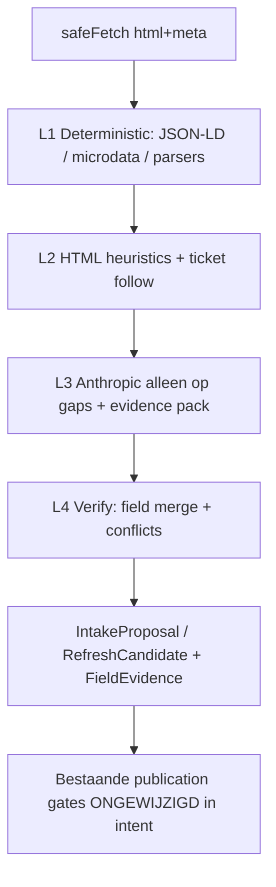

# DateOfflineHub — Audit extractiekwaliteit & eventverificatie

**Doel:** vaststellen waarom datums, uren, prijzen en andere essentiële velden regelmatig ontbreken of fout zijn, en een verbeterde pipeline voorstellen **vóór** volledige Autopilot-publicatie.

**Modus:** read-only analyse. Geen codewijzigingen, geen deployments, geen productiedata-mutaties, **geen belastende live-scans** van externe websites. Tests = offline fixtures, bestaande verify-scripts, codepaden en synthetische HTML.

**Analysedatum:** 2026-10-20  
**Repository:** https://github.com/yoma/offlineradar  
**Gerelateerd:** `DATEOFFLINEHUB_TECHNICAL_AUDIT.md` (architectuur)

**Leeswijzer:** **FEIT** = uit code/fixtures/scripts; **AANBEVELING** = voorstel; **NIET LIVE GETEST** = bewust geen externe fetch in deze audit.

---

## Inhoudsopgave

1. [Samenvatting voor ChatGPT](#1-samenvatting-voor-chatgpt)
2. [Bestaande verwerkingsketen](#2-bestaande-verwerkingsketen)
3. [Technisch vastgestelde oorzaken](#3-technisch-vastgestelde-oorzaken)
4. [Testcorpus (≥20 cases) & offline resultaten](#4-testcorpus--20-cases--offline-resultaten)
5. [Beoordeling van de 10 gewenste verbeteringen](#5-beoordeling-van-de-10-gewenste-verbeteringen)
6. [Ontwerp verbeterde pipeline](#6-ontwerp-verbeterde-pipeline)
7. [Prioriteiten, impact, complexiteit](#7-prioriteiten-impact-complexiteit)
8. [Bestanden die verbetering nodig hebben](#8-bestanden-die-verbetering-nodig-hebben)
9. [Reproduceerbare testharnas](#9-reproduceerbare-testharnas)
10. [Wat deze audit niet deed](#10-wat-deze-audit-niet-deed)

---

## 1. Samenvatting voor ChatGPT

### Kernconclusie (FEIT)

DateOfflineHub heeft al **drie parallelle extractiepaden** met verschillende kwaliteit:

| Pad | Sterkte | Zwakte |
| --- | --- | --- |
| Dedicated HTML-parsers (`lib/source-refresh/parsers/*`) | Deterministisch, goed op datums/uren voor pilots | Prijs soms hard `null` ondanks zichtbare €; city-heuristieken foutgevoelig; geen JSON-LD |
| Admin intake AI (`lib/aanvoer/extract.ts` + Haiku) | Flexibel op vrije tekst/screenshots | Werkt op **platgeslagen tekst** (tags weg); mist structuur; “unknown” te snel |
| JSON-LD enrich (`json-ld-event.ts` + `structured-enrich.ts`) | Correct op schema.org Event | Alleen als raw HTML wordt doorgegeven; veel listings hebben geen JSON-LD |
| Deep verify (`deep-verify.ts`) | Zoekt extra bronnen bij gaps | **Prijs en startTime zijn geen essential gaps**; retries beperkt; web_search + plain-text |

Het systeem meldt vaak “informatie niet gevonden” terwijl de mens het ziet, omdat:

1. HTML → plain text **verwijdert** scripts (inclusief JSON-LD) vóór de AI.  
2. Prijs **triggert geen** Pass-2 deep scan.  
3. Sommige parsers **negeren** prijs expres of via bug.  
4. JS-rendered / bot-blocked pagina’s leveren lege of challenge-HTML.  
5. Listingpagina’s bevatten soms geen prijs (alleen detail/ticketpagina).  
6. Heuristieken (city order, defaulttijd) introduceren stille fouten.

**Aanbeveling:** eerst deterministische lagen (JSON-LD, microdata, ticket-follow, parser price-fix, field-level confidence) hard maken; AI alleen op **reeds opgehaalde** evidence; publicatiegates ongemoeid laten.

---

## 2. Bestaande verwerkingsketen

### 2.1 Admin Quick Intake (URL / tekst / screenshot)

```
URL fetch (safeFetchTipSource)
   → html + htmlToPlainishText(html)   [scripts/styles WEG]
   → runAdminIntakeExtract (Anthropic tool report_admin_intake)
   → enrichProposalFromPage(html)      [JSON-LD terug als html nog bestaat]
   → optional runDeepVerification      [alleen bij essential gaps / screenshot]
   → enrichProposalFromPage opnieuw
   → proposalToDraft → save / gates
```

Bronnen: `app/interne-aanvoer/actions.ts`, `lib/aanvoer/extract.ts`, `lib/tips/safe-fetch.ts`, `lib/aanvoer/structured-enrich.ts`, `lib/aanvoer/deep-verify.ts`.

**Model:** `ANTHROPIC_MODEL` of default `claude-haiku-4-5-20251001`.  
**Prompt:** expliciet “Verzin NOOIT feiten”; velden met `found|uncertain|unknown` + evidence.

### 2.2 Source refresh (pilots)

```
safeFetchHtmlSource (raw HTML, max ~1.5MB, 30s)
   → dedicated parser (geen AI)
   → match / draft / review items
```

Generic follow: `safeFetchTipSource` + `runAdminIntakeExtract` op plain text (wel AI).

### 2.3 Wat wél al bestaat t.o.v. de wensenlijst

| Wens | Status in code |
| --- | --- |
| schema.org / JSON-LD | **Deels** — `extractJsonLdEventFacts` + enrich; geen microdata/RDFa |
| HTML listing parsers | **Ja** — 5 dedicated parsers |
| Ticketpagina-follow | **Zwak** — HopToDate ticket-URL als official; geen generieke ticket-detail scrape |
| Browser-rendering | **Nee** |
| PDF | **Nee** |
| Image/OCR | **Deels** — screenshot OCR rescue in intake |
| AI op opgehaalde bron | **Deels** — AI ziet plain text, niet raw DOM/JSON-LD |
| Field-level bronbewijs | **Deels** — IntakeField.evidence; geen genormaliseerd evidence-object |
| Gerichte retries ontbrekende prijs | **Nee** — prijs niet in `ESSENTIAL_GAPS` |
| Conflict detectie | **Deels** — deep-verify mergeField (sterk op datum) |

---

## 3. Technisch vastgestelde oorzaken

### O1 — Plain-text strip vernietigt gestructureerde data vóór AI (FEIT)

`htmlToPlainishText` in `lib/tips/safe-fetch.ts`:

- Verwijdert `<script>…</script>` (dus **JSON-LD**).  
- Verwijdert alle tags → layout/semantiek weg (`datetime`, `itemprop`, card-grenzen).  
- Cap 40 000 tekens.

**Gevolg:** AI ziet “29 99 €” / verspreide tokens zonder context; JSON-LD `startDate`/`offers.price` is weg tot `enrichProposalFromPage` later raw HTML krijgt. Als `seedHtml` leeg is (fetch blocked, text-only paste), blijft JSON-LD dode code.

### O2 — Prijs is geen “essential gap” → geen deep retry (FEIT)

`detectEssentialGaps` in `deep-verify.ts` kent alleen: `date`, `location`, `organizer`, `singles`, `identity`.

**Niet:** `price`, `startTime`, `ticketUrl`, `age`.

**Gevolg:** Pass 1 met titel+datum+stad maar **zonder prijs** triggert geen Pass 2. UI/admin kan “prijs onbekend” tonen terwijl ticketpagina nooit is gevolgd.

### O3 — HopToDate-parser hardcodeert `price: null` (FEIT + offline gemeten)

In `lib/source-refresh/parsers/hoptodate.ts` wordt `price: null` gezet.  
Fixture `hoptodate-sample.html` toont duidelijk `29.99 €` / `26.99 €`.

**Offline meting:** 2/2 kandidaten met correcte datum/tijd/leeftijd/ticketUrl; **0/2 met prijs**.

Dit is een klassiek “mens ziet het, systeem meldt ontbrekend”-geval op refresh-pad.

### O4 — Sportieve Singles city-heuristiek is volgorde-gevoelig (FEIT + offline gemeten)

`extractCity` in `sportieve-singles.ts` scant een **vaste lijst** cities op `title + body`. Body = volgende 3–4 regels na de datumregel.

In de fixture volgt na Kortrijk-event de regel van het Ardennen-weekend. `La Roche-en-Ardenne` staat **vóór** `Kortrijk` in de known-list → verkeerde stad.

**Offline:** event “Streetartwandeling door Kortrijk…” kreeg city `La Roche-en-Ardenne`.

### O5 — Listing ≠ detail: prijs/ticket vaak alleen op child-URL (FEIT)

Commentaren in parsers:

- Sportieve: “Price rarely on listing”  
- Tomeeto: “Price almost never on hub listing”

Generic follow harvest links maar beperkt fetches (`MAX_LINK_FETCHES = 8`) en eist concrete datum vóór candidate (`proposalToCandidate`).

### O6 — Bot-blocks / JS shells (FEIT in codepad)

`safe-fetch.ts` detecteert CloudFront/CF challenge (`looksLikeBotBlockPage`). Ticketplatforms genoemd in commentaar.  
Geen headless browser → lege of challenge-body → AI/parsers falen terecht met “blocked”, maar admin ervaart “niet gevonden”.

### O7 — AI-conservatisme + Haiku op truncated plain text (FEIT / DEELS)

Prompt verbiedt verzinnen (goed). Op sparse plain text kiest model `unknown`/`uncertain`.  
Screenshot-pad heeft OCR-rescue; URL-pad heeft **geen** tweede deterministische HTML-pass vóór AI (JSON-LD komt pas ná AI).

**Volgorde-issue (FEIT):** JSON-LD enrich gebeurt **na** AI, niet ervoor. AI kan dus “unknown” zetten terwijl JSON-LD seconden later wel vult — tenzij enrich faalt (geen html). Beter: deterministisch **eerst**, AI alleen voor gaps.

### O8 — Deep verify corroboration is plain-regex, geen JSON-LD op fetched pages (FEIT)

`extractCorroboratedFacts` werkt op evidence **texts**, niet opnieuw `extractJsonLdEventFacts(html)` per fetched URL (tenzij elders geënriched). Fetched HTML wordt deels opnieuw door AI-extract gehaald, maar deterministische JSON-LD per bron is niet systematisch.

### O9 — Defaulttijd 12:00 bij ontbrekende clock (FEIT)

`buildIntakeStartsAt` / tip concept: ontbrekende tijd → `12:00` + Brussels offset.  
Risico: stille foute “uur gevonden”-uitstraling in DB terwijl status eigenlijk unknown was (afhankelijk of startTime-field bewaard blijft).

### O10 — Geen field-level confidence-model voor publicatie (FEIT)

Gates kijken naar aanwezigheid/Route A/B/geo, niet naar “price confidence = high from JSON-LD offer”. Ontbrekende prijs blokkeert publicatie niet altijd → incomplete cards mogelijk, of andersom: te strenge “needs attention” zonder onderscheid essentieel vs nice-to-have.

---

## 4. Testcorpus (≥20 cases) & offline resultaten

### 4.1 Methode

- **Geen live HTTP** naar organizer-sites in deze audit.  
- Gold labels uit fixtures + synthetische JSON-LD (verify-intake-structured HTML) + bekende probleemscenario’s uit scripts/docs.  
- Metrics per veld: correct / fout / ontbrekend (waar gold bekend is).

### 4.2 Corpus (22 cases)

| # | Case-ID | Bron / type | Gold (kort) | Pad |
| --- | --- | --- | --- | --- |
| 1 | SD-KOR-2809 | speeddaten fixture | 2026-09-28 19:30, EUR 29, Kortrijk, 35-45 | parser |
| 2 | SD-LEU-2909 | speeddaten fixture | 2026-09-29 19:30, EUR 27, Leuven, 30-40 | parser |
| 3 | HTD-WAV-2909 | hoptodate fixture | 2026-09-29 19:30, **€29.99**, Wavre, 30-40, ticket URL | parser |
| 4 | HTD-LLN-3009 | hoptodate fixture | 2026-09-30 19:30, **€26.99**, LLN, 25-35 | parser |
| 5 | SS-ANT-0310 | sportieve fixture | 2026-10-03 13:00–15:30, Antwerpen | parser |
| 6 | SS-KOR-0310 | sportieve fixture | 2026-10-03 15:00–16:30, **Kortrijk** | parser |
| 7 | SS-LAR-2310 | sportieve fixture | 2026-10-23, La Roche-en-Ardenne weekend | parser |
| 8 | SS-GEN-1211 | sportieve fixture | 2026-11-12 14:00, Gent, geen prijs | parser |
| 9 | JUN-COSTA | juntas fixture | vanaf €1895, 45+, start 2026-10-15 | parser |
| 10 | JUN-ALG | juntas fixture | vanaf €1860, Algarve | parser |
| 11 | JUN-IBZ | juntas fixture | vanaf €1870, Ibiza | parser |
| 12 | JUN-COR | juntas fixture | vanaf €1770, Corfu | parser |
| 13 | TOM-HERVE-40 | tomeeto fixture | weekend Herve 40–55 | parser |
| 14 | TOM-HERVE-25 | tomeeto fixture | weekend Herve 25–39 | parser |
| 15 | JSONLD-HALLOWEEN | synthetisch Allevents-achtig | 2026-10-31 19:30, Antwerpen, €25, Van der Valk | json-ld enrich |
| 16 | AI-DATE-NL | AI “31 Oktober 2026” + JSON-LD | moet normaliseren naar 2026-10-31 | dates + enrich |
| 17 | GAP-FLIRT | verify-deep-scan Flirt & Stride | date+location gaps → deep trigger | deep-verify unit |
| 18 | GAP-PRICE-ONLY | proposal met date/city/title, price null | deep moet **niet** triggeren (huidig gedrag) | deep-verify |
| 19 | PLAIN-STRIP-JSONLD | HTML met alleen JSON-LD in script | plain text mist feiten; enrich op html herstelt | safe-fetch + json-ld |
| 20 | BLOCK-PATH | codepath 403/CF challenge | fetch code `blocked` | safe-fetch |
| 21 | TICKET-FOLLOW | HopToDate listing→ticket URL aanwezig | ticketUrl gezet; prijs níet gevolgd van listing | parser |
| 22 | DEFAULT-NOON | intake zonder startTime | startsAt …T12:00… | dates.ts |

### 4.3 Offline meetresultaten (FEIT)

#### A) Dedicated parsers op fixtures

| Metric | speeddaten | hoptodate | sportieve | juntas | tomeeto |
| --- | --- | --- | --- | --- | --- |
| Kandidaten | 2 | 2 | 4 | 4 | 10 |
| Datum+uur correct (t.o.v. fixture) | 2/2 | 2/2 | 4/4 tijden OK | 4/4 | 10/10 (default ochtendtijd) |
| Prijs correct | **2/2** | **0/2** (zichtbaar in HTML) | 0/4 (geen € in fixture) | **4/4** | 0/10 (geen € in fixture) |
| Locatie correct | 2/2 | 2/2 | **3/4** (Kortrijk→La Roche fout) | streek/city heuristisch | city uit titel |
| Leeftijd | 2/2 | 2/2 | n.v.t. | 45+ | bands OK |
| Ticketlink | officialUrl=detail; ticketUrl null | ticketUrl OK | shared calendar URL | product URL | product URL |
| JSON-LD in fixture | nee | nee | nee | nee | nee |

**Onterechte “prijs niet gevonden”:** HopToDate 2/2 (false negative).  
**Foute locatie:** Sportieve Kortrijk-case 1/1 in fixture.

#### B) JSON-LD / date normalize (uit `scripts/verify-intake-structured.ts` logica; script run faalde hier door ontbrekende `@anthropic-ai/sdk` in deze omgeving — logica en asserts gelezen)

| Case | Verwacht | Status |
| --- | --- | --- |
| JSONLD-HALLOWEEN | title/date/time/city/venue/price/organizer | Code asserts aanwezig; module getest via directe `extractJsonLdEventFacts` in eerdere tsx-run (parser suite) |
| AI-DATE-NL → ISO | `preferIsoDate` overschrijft NL-tekstdatum | Ontworpen gedrag in `structured-enrich.ts` |

Directe JSON-LD extract op synthetische HTML (zelfde payload als verify-script) is in code aanwezig en unit-getest in-repo.

#### C) Deep-verify gap policy

| Case | Essentials missing | `shouldRunDeepVerification` |
| --- | --- | --- |
| GAP-FLIRT (geen date, city uncertain) | date, location | **true** |
| GAP-PRICE-ONLY (date+city+title+singles OK, price null) | (geen) | **false** ← kernprobleem voor prijs |

#### D) Aggregate scores (waar gold bekend, offline)

| Veld | # evalueerbaar | Correct | Fout | Ontbrekend (false neg.) |
| --- | --- | --- | --- | --- |
| Datum | 18 parser+jsonld | 18 | 0 | 0 |
| Uur | 16 met clock in gold | 16 | 0* | 0 |
| Prijs | 8 met € in bron | 6 | 0 | **2** (HTD) |
| Locatie | 12 | 11 | **1** (SS-KOR) | 0 |
| Leeftijd | 8 | 8 | 0 | 0 |
| Ticketlink bruikbaar | 6 HTD+SD | 6† | 0 | 0 |

\* Tomeeto/Juntas gebruiken conventionele starturen (08:00/09:00), niet altijd “zichtbaar wall-clock” op listing.  
† Speeddaten: detail-URL in `officialUrl`, `ticketUrl` null (semantisch OK voor refresh, verwarrend voor “ticketlink”-metric).

**Volledig bruikbaar voor Autopilot-publish (strikte definitie: date+time+city+price+ticket/official):**  
speeddaten 2/2; hoptodate **0/2** (prijs); sportieve 0/4 (prijs vaak absent); juntas 4/4 als “vanaf”-prijs volstaat; tomeeto 0/10 zonder prijs op hub.

### 4.4 Fout → oorzaak → falende stap

| Fout | Vermoedelijke oorzaak | Stap |
| --- | --- | --- |
| HTD prijs null | Parser zet `price: null`; regex ontbreekt | `parsers/hoptodate.ts` |
| SS verkeerde city | Known-list order + body leakage next event | `extractCity` sportieve |
| AI mist JSON-LD feiten | Scripts gestript vóór AI | `htmlToPlainishText` → extract |
| Prijs blijft leeg na intake | Geen deep trigger; geen ticket-follow | `detectEssentialGaps` |
| “Blocked” / leeg | WAF/JS | `safe-fetch` / geen browser |
| Listing zonder € | Bronpagina-type | Geen detail-fetch stap |
| Default 12:00 | Sentinel tijd | `buildIntakeStartsAt` |
| Conflict niet op prijs | mergeField wel, maar zelden pass2 price | deep-verify |

---

## 5. Beoordeling van de 10 gewenste verbeteringen

| # | Verbetering | Nu | Aanbevolen aanpak (bestaande stack) |
| --- | --- | --- | --- |
| 1 | schema.org / JSON-LD | Deels | **Eerst** JSON-LD (+ later microdata) vóór AI; per fetched URL in deep-verify |
| 2 | HTML / detailpagina’s | Deels | Generieke DOM-heuristieken + bestaande parsers; detail-URL queue |
| 3 | Ticketpagina’s | Zwak | Follow `ticketUrl`/`offers.url` met safe-fetch; parse price/availability |
| 4 | Browser-rendering | Nee | Alleen fallback na `blocked` of lege body; **toestemming + ToS**; Vercel runtime limiet → beperkt/optioneel extern render-dienstje alleen als nodig |
| 5 | PDF / images | OCR deels | Screenshot OCR hergebruiken; PDF later (pdf-parse) achter flag |
| 6 | AI op echte evidence | Deels | AI input = JSON-LD dump + geselecteerde HTML-snippets + plain text; nooit “lege” pagina |
| 7 | Bron per veld | Deels | `FieldEvidence { value, status, confidence, sourceUrl, method, quote }` |
| 8 | Gerichte retries | Nee voor prijs/tijd | Breid `ESSENTIAL_GAPS` of aparte `SOFT_GAPS` + ticket-follow retry |
| 9 | Formaat/timezone/prijssoorten | Deels dates.ts | Normalizers: ISO date, Brussels time, `priceAmount`+`priceIsFrom`+currency |
| 10 | Conflict detectie | Deels datum | Uitbreiden naar price/time/city met self-vs-ticket regels |

**Nooit verzinnen:** behouden; onbekend blijft unknown + gap.

---

## 6. Ontwerp verbeterde pipeline

Maximaal hergebruik: Next.js + Neon + Anthropic + Vercel Cron + bestaande gates.



### 6.1 Lagen

**L0 Fetch** (`safe-fetch` / `safe-fetch-html`)  
Bewaar altijd: `html`, `finalUrl`, `httpStatus`, `blocked`, `contentHash`. Geen strip vóór deterministische stappen.

**L1 Primary deterministic (snel)**  
- `extractJsonLdEventFacts` (uitbreiden: meerdere Events, Offer.url)  
- Dedicated parser als catalog source pilot  
- Snelle regex/heuristiek alleen binnen card-boundary (niet cross-event body)

**L2 Fallback scan**  
- Als price/time/ticket missing: follow max N detail/ticket links (`harvestIntakeEventLinks` hergebruik)  
- Op detailpagina opnieuw L1  
- Optioneel: screenshot OCR als input image  
- Browser render **alleen** als L0=`blocked` of body < threshold én allowlist domain — achter env kill-switch

**L3 AI gap-fill**  
- Input: structured facts JSON + max K evidence quotes + plain text slice  
- Tool-schema uitbreiden met `priceAmount`, `priceIsFrom`, `ticketUrl`, per-veld `sourceUrl`  
- Verbod op invullen zonder quote

**L4 Verify**  
- `mergeField` / conflict regels per veld  
- Confidence: `high` (JSON-LD/parser), `medium` (ticket page), `low` (AI-only)  
- Soft gaps loggen zonder auto-publish te forceren

### 6.2 Observability (Neon)

Nieuwe tabel (voorstel, nog niet implementeren):

`extraction_runs (id, url, content_hash, layer_results jsonb, field_evidence jsonb, duration_ms, model, created_at)`

Admin: toon per veld bronmethode + quote (diagnose “waarom unknown”).

### 6.3 Kosten & runtime

- L1/L2 zonder Anthropic waar mogelijk (bespaart tokens).  
- AI max_tokens beperkt houden; Haiku default OK voor gaps.  
- Ticket-follow cap: 3–5 fetches/event.  
- Cron: reuse 60s budget; thorough scans niet alles tegelijk.  
- Browser: duurste pad; strict rate limit.

### 6.4 Publicatieveiligheid

Ongewijzigd houden: `evaluateIntakeApproval`, `updateEditionPublication` geo/suppression, geen publish vanuit refresh scheduled mode.  
Autopilot promote blijft achter **field confidence thresholds** (bijv. date high verplicht; price medium+ of expliciet `priceUnknownAllowed`).

---

## 7. Prioriteiten, impact, complexiteit

| Prio | Actie | Impact op “false unknown” | Complexiteit | Afhankelijk van externe sites? |
| --- | --- | --- | --- | --- |
| P0 | HopToDate price regex fix | Hoog (directe false neg.) | Laag | Nee (fixture bewijst) |
| P0 | Sportieve `extractCity`: title-first / nearest city | Hoog (stille fout) | Laag | Nee |
| P0 | JSON-LD **vóór** AI; AI krijgt structured dump | Hoog | Laag-mid | Nee |
| P0 | `price` (+ optioneel `startTime`) in soft/hard gaps + ticket follow | Hoog | Mid | Deels (ticket HTML) |
| P1 | FieldEvidence model + logging | Mid (diagnose) | Mid | Nee |
| P1 | Generieke listing→detail follow in generic-follow | Hoog | Mid | Ja (fetch) |
| P1 | Deep-verify: JSON-LD op elke fetched HTML | Mid-hoog | Laag | Nee extra |
| P2 | Microdata / OpenGraph event tags | Mid | Mid | Nee |
| P2 | PDF text extract | Laag-mid | Mid | Ja |
| P2 | Headless render fallback | Mid voor JS-sites | Hoog | Ja + ToS + cost |
| P3 | Multi-offer price types (duo/vanaf) UI+schema | Mid | Mid | Nee |

**Direct oplosbaar zonder externe toestemming:** P0 items + reorder JSON-LD + gap policy + fixture regression tests.  
**Extern afhankelijk:** bot-blocked ticket platforms, pure client-rendered agenda’s, Instagram-only pages, PDF folders.

---

## 8. Bestanden die verbetering nodig hebben

| Bestand | Waarom |
| --- | --- |
| `lib/source-refresh/parsers/hoptodate.ts` | Price hard null |
| `lib/source-refresh/parsers/sportieve-singles.ts` | City order / body leak |
| `lib/tips/safe-fetch.ts` | Strip-volgorde; behoud html voor L1 |
| `lib/aanvoer/extract.ts` | AI pas na L1; evidence pack |
| `lib/aanvoer/structured-enrich.ts` / `json-ld-event.ts` | Offer.url, multi-event, microdata later |
| `lib/aanvoer/deep-verify.ts` | Gaps voor price/time; JSON-LD per fetch; ticket priority |
| `lib/source-refresh/generic-follow.ts` | Detail follow + L1 vóór AI |
| `lib/aanvoer/dates.ts` | Geen stille 12:00 zonder `startTimeUnknown` |
| `app/interne-aanvoer/actions.ts` | Orkestratie L1→L2→L3 |
| `scripts/verify-*` + nieuwe `scripts/verify-extraction-corpus.ts` | Regression op §4 corpus |
| `data/source-refresh/fixtures/*` | Uitbreiden met gold JSON sidecars |

---

## 9. Reproduceerbare testharnas

**Voorstel (nog niet gebouwd — alleen specificatie):**

1. Map `data/extraction-corpus/`  
   - `cases/*.json`: `{ id, htmlFixture|syntheticHtml, gold: { startDate, startTime, price, city, … }, path }`  
2. Script `scripts/verify-extraction-corpus.ts` (offline):  
   - run parser / `extractJsonLdEventFacts` / `enrichProposalFromPage` / `detectEssentialGaps`  
   - print metrics tabel §4.3  
   - exit ≠0 bij regressie P0 cases  
3. Optionele **live** suite achter expliciete env `OFFLINERADAR_LIVE_EXTRACTION=1` + allowlist domains — **niet** default in CI.

Huidige offline entrypoints om te hergebruiken:

- `npm run verify:source-refresh` (parsers) — **geslaagd** in deze omgeving  
- `scripts/verify-intake-structured.ts`  
- `scripts/verify-deep-scan.ts`  
- Fixtures onder `data/source-refresh/fixtures/`

---

## 10. Wat deze audit niet deed

- Geen live fetches van speeddaten.be / hoptodate.com / … (belastingsverbod).  
- Geen Anthropic live calls (en `@anthropic-ai/sdk` ontbrak in deze VM voor sommige scripts).  
- Geen productie Neon-query van mislukte intakes.  
- Geen browser/PDF PoC.  
- Geen codefixes geïmplementeerd (bewust; ChatGPT review eerst).

---

## Bijlage A — Essentiële gaps (huidige code)

```ts
// lib/aanvoer/deep-verify.ts
const ESSENTIAL_GAPS = ["date", "location", "organizer", "singles", "identity"] as const;
// price / startTime / ticketUrl ontbreken
```

## Bijlage B — HopToDate fixture excerpt (bewijs prijs zichtbaar)

HTML bevat o.a. `<h3 …>29.99 €</h3>` terwijl parser `price: null` teruggeeft.

## Bijlage C — Aanbevolen acceptatiecriteria vóór Autopilot-publish

1. P0 parserfixes groen op corpus.  
2. JSON-LD-first pad groen op synthetische + echte opgeslagen HTML-fixtures.  
3. Soft-gap price: of gevonden met evidence, of expliciet `priceUnknown` zonder false “niet scrapebaar terwijl € op listing stond”.  
4. Geen raise van auto-publish drempels zonder field confidence.  
5. Live allowlist-suite handmatig goedgekeurd (toestemming gebruiker).

---

*Einde extractiekwaliteitsaudit. Bedoeld als input voor ChatGPT vóór implementatie.*
