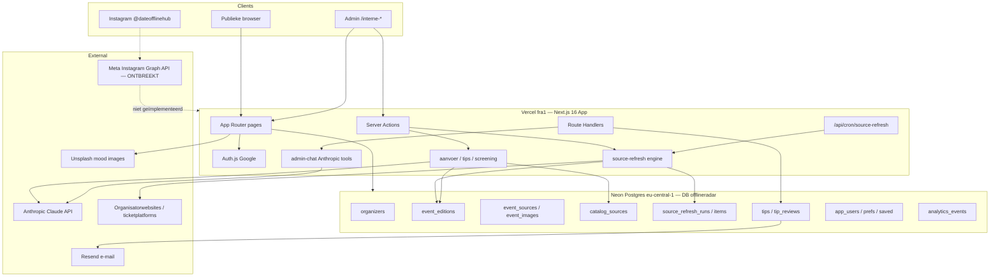
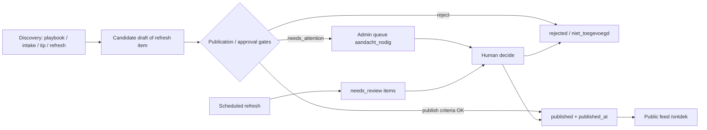

# DateOfflineHub — Technische audit & overdrachtsrapport

**Doel:** dit document is een standalone technische overdracht voor een externe AI-architect (bijv. ChatGPT). Het beschrijft de bestaande codebase, eventlevenscyclus, automatisering, beveiliging en ontbrekende bouwstenen voor een “Autopilot” (eventdiscovery + verwerking + Instagram).

**Auditmodus:** read-only analyse van repository, migraties, docs en (waar toegankelijk) hostingmetadata. Geen codewijzigingen, geen installs, geen deployments, geen databasewrites.

**Repository:** `https://github.com/yoma/offlineradar` (publiek; package name `dateofflinehub`)  
**Analysedatum:** 2026-10-20  
**Primaire branch:** `main`  
**Productnaam:** DateOfflineHub (historische codenaam OfflineRadar; veel env-vars en DB-namen behouden `OFFLINERADAR_*` / `offlineradar`)

---

## Leeswijzer: feiten vs. aanbevelingen

| Label | Betekenis |
| --- | --- |
| **FEIT** | Vastgesteld uit code, SQL-migraties, `package.json`, `vercel.json`, GitHub API of Vercel domain-API |
| **DEELS GEVARIFIEERD** | Sterke aanwijzing in code/config, maar productie-runtime (env-waarden, live DB-inhoud, abonnementen) niet bevestigd |
| **NIET GEVARIFIEERD** | Kon niet worden bevestigd zonder secrets/dashboardtoegang of live queries |
| **AANBEVELING** | Voorstel voor Autopilot / architectuur; geen bestaande functionaliteit |

Geheimen, tokens, wachtwoorden en persoonsgegevens worden **niet** weergegeven. Alleen **namen** van configuratievariabelen en hun doel.

---

## 1. Algemene architectuur

### 1.1 Stack (FEIT)

| Laag | Technologie | Bron |
| --- | --- | --- |
| Taal | TypeScript 5 | `package.json`, `tsconfig.json` |
| Runtime UI | React 19.2 | `package.json` |
| Framework | **Next.js 16.3.6** (App Router) | `package.json`, `app/` |
| Styling | Tailwind CSS 4, shadcn/Radix, Lucide | `package.json`, `components/ui/`, `app/globals.css` |
| Auth | Auth.js / next-auth **v5 beta** + Google OAuth | `auth.ts`, `app/api/auth/[...nextauth]/route.ts` |
| Database | **Neon Postgres** (serverless driver `@neondatabase/serverless`) | `lib/tips/db.ts`, `db/migrations/` |
| E-mail | Resend | `lib/email/resend.ts` |
| AI | Anthropic SDK (`@anthropic-ai/sdk`) | `lib/screening/ai/`, `lib/aanvoer/`, `lib/tips/`, `lib/admin-chat/` |
| Hosting | Vercel, regio **fra1** (Frankfurt) | `vercel.json`, `app/layout.tsx` (`preferredRegion = "fra1"`) |
| Cron | Vercel Cron → `/api/cron/source-refresh` dagelijks `0 4 * * *` | `vercel.json` |

**Niet aanwezig in dependencies/code (FEIT):** Supabase client, Supabase Edge Functions, OpenAI SDK, Meta/Instagram Graph API SDK, Stripe, Redis/Upstash, Prisma/Drizzle ORM, GitHub Actions workflows.

### 1.2 Frontend-architectuur (FEIT)

App Router onder `app/`:

| Route | Rol |
| --- | --- |
| `/` | Homepage: hero-zoek, “Binnenkort”-strip, tipsectie |
| `/ontdek` | Publieke eventcatalogus / zoekresultaten |
| `/event/[slug]` | Eventdetail |
| `/bewaard` | Opgeslagen events (ingelogde gebruiker) |
| `/account` | Account/voorkeuren |
| `/inloggen` | Google sign-in |
| `/feedback`, `/over`, `/privacy` | Content/feedback |
| `/interne-*` | Admin-cockpit (allowlist) |

Admin UI (allemaal achter `resolveTipsAdminAccess()`):

- `/interne-dashboard` — overzicht/analytics
- `/interne-aanvoer` — Quick Intake + Source Map + kandidatenqueue
- `/interne-events` — catalogusbeheer + refresh UI
- `/interne-events/refresh/[runId]` — refresh-run detail
- `/interne-tips` — tipqueue
- `/interne-goedkeuren` — goedkeuringsflow
- `/interne-preview` — interne preview (flag)
- `/interne-feedback` — beta-feedback admin

Publieke componenten: `components/home/`, `components/events/`, `components/discover/`, `components/filters/`, `components/tips/`, `components/layout/site-nav.tsx`.

### 1.3 Backend-architectuur (FEIT)

Geen aparte API-server. Backend = Next.js Route Handlers + Server Actions.

**API-routes (`app/api/`):**

| Pad | Functie |
| --- | --- |
| `/api/auth/[...nextauth]` | Auth.js handlers |
| `/api/cron/source-refresh` | Geplande source refresh (Bearer `CRON_SECRET`) |
| `/api/tips`, `/api/tips/admin` | Tip indienen / admin tip API |
| `/api/interne-admin-chat` | Admin-chat agent (Anthropic + tools) |
| `/api/interne-aanvoer/asset/[id]` | Screenshot-asset ophalen (admin) |
| `/api/events/[id]/report` | Publieke “geen singlesevent”-melding |
| `/api/analytics` | Anonieme productanalytics |

**Domeinlogica (`lib/`):**

- `lib/events/` — Neon catalogus CRUD + consumer mapping
- `lib/events.ts` — publieke feed (canonical Neon vs mock)
- `lib/source-refresh/` — parsers, engine, scheduler, match/dedupe
- `lib/aanvoer/` — admin intake, AI extract, deep verify, publication gate
- `lib/tips/` — tipportal
- `lib/screening/` — Route A/B screening pilot (+ Anthropic concept layer)
- `lib/admin-chat/` — tool-calling admin assistant
- `lib/users/`, `lib/organizers/`, `lib/analytics/`, `lib/feedback/`

**Data:**

- Canonical: Neon Postgres (`offlineradar`)
- Rollback/mock: `data/events.ts` wanneer `OFFLINERADAR_EVENTS_CANONICAL_FEED` ≠ `1`
- Pilot/discovery seed data: `data/pilot/*`
- Handmatige SQL: `db/migrations/*.sql` (niet auto-run bij boot)

### 1.4 Hosting, deployment, domein

| Item | Status | Bron |
| --- | --- | --- |
| Vercel project naam | `dateofflinehub` | Vercel `list_projects` |
| Vercel project id | `prj_RqZkXkAm4VjIACXAT9z2Q21kUsEL` | idem |
| Team | YOMA (`yomai`, `team_pHadNkiBHr7YZo3h5XLLLR1E`) | Vercel `list_teams` |
| Cron regio | `fra1` | `vercel.json` |
| Prefered serverless regio | `fra1` (dicht bij Neon EU) | `app/layout.tsx` |
| Canonical product-URL in metadata | `https://dateofflinehub.be` | `app/layout.tsx` `metadataBase` |
| OpenGraph URL | `https://dateofflinehub.vercel.app` | `app/layout.tsx` |
| Custom domain | `dateofflinehub.be` geverifieerd, DNS bij externe nameservers (`ns1/ns2.iezie.eu`), serviceType `external` | Vercel `get_domain` |
| GitHub Actions | **0 workflows** | GitHub API `actions/workflows` |
| Deployment details / env-waardes productie | **NIET GEVARIFIEERD** (Vercel `get_project` / `list_deployments` / `filter_project_envs` gaven 404/403 vanuit deze agent-scope) | — |

**Deploymodel (FEIT uit structuur):** Git push naar GitHub → Vercel project gekoppeld aan repo (standaard Vercel Git-integratie). Geen CI-workflows in `.github/`.

### 1.5 GitHub & branches (FEIT)

- Repo: `yoma/offlineradar`, default branch `main`, publiek
- Lokale remote branches gezien: `main`, `cursor/meet-intent-docs-9de1`
- Feature-work in Cursor volgt conventie `cursor/<naam>-…`
- Geen monorepo; één Next-app in root

### 1.6 Database & externe diensten (FEIT)

**Neon Postgres**

- Project-id hard-coded als verwacht: `little-haze-16039117`
- Endpoint-id hard-coded: `ep-fancy-hat-b2jkbryx`
- Database naam moet `offlineradar` zijn
- Host moet `neon.tech` + `eu-central-1` + endpoint-id bevatten
- Guard: `assertOfflineRadarDbConfig()` in `lib/tips/db.ts` (gedeeld via `lib/events/db.ts`)

**Externe diensten in code:**

| Dienst | Doel | Config |
| --- | --- | --- |
| Neon | Eventcatalogus, tips, users, analytics, refresh | `OFFLINERADAR_DATABASE_URL`, `OFFLINERADAR_NEON_PROJECT_ID` |
| Google OAuth | Login (users + admin identity) | `AUTH_GOOGLE_ID`, `AUTH_GOOGLE_SECRET`, `AUTH_SECRET` |
| Anthropic Claude | Screening, tip-AI, intake extract/OCR/deep-verify, admin-chat | `ANTHROPIC_API_KEY`, `ANTHROPIC_MODEL` (default `claude-haiku-4-5-20251001`) |
| Resend | Transactionele mail (tips status) | `RESEND_API_KEY`, `OFFLINERADAR_EMAIL_FROM` |
| Unsplash | Mood/sfeerbeelden (remote images) | hard-coded URLs; `next.config.ts` remotePatterns |
| Vercel Cron | Dagelijkse refresh-trigger | `CRON_SECRET`, `OFFLINERADAR_SCHEDULED_REFRESH` |

**Supabase:** niet gebruikt (FEIT).  
**Meta/Instagram Publishing API:** niet geïmplementeerd (FEIT).

### 1.7 Geplande taken / workflows (FEIT)

1. **Vercel Cron** `0 4 * * *` → `GET /api/cron/source-refresh`
   - Auth: `Authorization: Bearer $CRON_SECRET`
   - Kill switch: alleen actief als `OFFLINERADAR_SCHEDULED_REFRESH=1` (default OFF)
   - Batch: max 3 bronnen/tick, concurrency 2
   - **Publiceert nooit** automatisch vanuit scheduled mode
2. **Geen GitHub Actions**
3. **Geen Supabase Edge Functions / pg_cron in migraties**
4. **Veel CLI-scripts** onder `scripts/` voor migrate/import/verify/refresh (handmatig of lokaal met `.env.local`)

### 1.8 Bestaande AI-integraties (FEIT)

| Module | Bestand(en) | Rol | Beslist publicatie? |
| --- | --- | --- | --- |
| Concept screening | `lib/screening/ai/anthropic-screener.ts` | Route A/B conceptgeschiktheid | Nee (alleen concept) |
| Tip AI prep/scan | `lib/tips/ai-prep.ts`, `ai-scan.ts`, `tip-screener.ts` | Tip normaliseren / voorstellen | Nee |
| Admin intake extract | `lib/aanvoer/extract.ts` | URL/tekst/screenshot → draft velden | Nee alleen; gate beslist |
| Screenshot OCR | `lib/aanvoer/screenshot-ocr.ts` | Tekst uit screenshot | Nee |
| Deep verify | `lib/aanvoer/deep-verify.ts` | Extra broncheck / conflictdetectie | Kan `canPublish` beïnvloeden via gates |
| Admin chat agent | `lib/admin-chat/agent.ts` + `tools.ts` | Scan/assess URL via tools | Drafts mogelijk; geen Instagram |

Productregel herhaaldelijk in docs/code: **AI output is nooit de enige waarheid; geen blinde auto-approval van twijfelachtige content.** Wel bestaat er een **deterministische** auto-publish path wanneer alle harde checks groen zijn (zie §2.8).

### 1.9 Architectuurdiagram (Mermaid)



---

## 2. Eventbeheer — levenscyclus

### 2.1 Waar events worden opgeslagen (FEIT)

**Canonical storage:** Neon-tabel `event_editions` (+ gerelateerde tabellen), schema in `db/migrations/20260926_events_catalog_v1.sql`, typed in `types/event-catalog.ts`, CRUD in `lib/events/neon-store.ts`.

**Consumer projection:** `Event` in `types/event.ts`, gemapt via `lib/events/map-to-consumer.ts`.

**Publieke feed switch (`lib/events.ts`):**

- `OFFLINERADAR_EVENTS_CANONICAL_FEED=1` → alleen Neon `publication_status = 'published'` (max 500 bundles), gefilterd met `isRouteABListable`
- anders → mock `data/events.ts` + legacy `isEventListable` (socialSuitability)

### 2.2 Tabellen, velden, relaties (FEIT)

```
organizers 1──* event_series
organizers 1──* event_editions
event_series 1──* event_editions
event_editions 1──* event_sources
event_editions 1──* event_images
catalog_sources (optioneel → organizers)
source_refresh_runs → catalog_sources
source_refresh_items → runs + optioneel event_editions
```

#### `organizers`
`id`, `slug` (unique), `name`, `website_url`, timestamps

#### `event_series`
`id`, `organizer_id`, `slug` (unique per organizer), `name`, `description`

#### `event_editions` (kern)
Belangrijke kolommen:

| Groep | Velden |
| --- | --- |
| Identiteit | `id`, `slug` (unique), `organizer_id`, `series_id`, `title` |
| Tijd | `starts_at`, `ends_at`, `timezone` (default `Europe/Brussels`) |
| Locatie | `venue_name`, `address`, `city`, `postal_code`, `region`, `country` (default `BE`), `latitude`, `longitude` |
| Eligibility | `eligibility_route` (`route_a`/`route_b`/`unknown`), `singles_oriented`, `singles_only`, evidence velden, `meet_formula*`, `min_age`/`max_age`/`age_rule`, `eligibility_json` |
| Taxonomie | `category` (`dating`/`meet_new_people`/`social`), `sub_category`, `activities` JSONB, `tags` JSONB |
| Prijs/capaciteit | `price_*`, `availability_status`, `spots_remaining`, `booking_deadline`, `availability_note` |
| Tekst | `short_description`, `description`, `internal_notes`, `practical_info` |
| Publicatie | `publication_status`, `approved_at`, `published_at`, `rejected_at`, `expired_at` |
| Freshness | `last_checked_at`, `source_checked_at`, `next_check_at` |
| Audience | `social_suitability`, `gender_availability`, `known_audience_genders`, preferred age velden |

**Publicatiestatussen (CHECK):**  
`candidate` | `under_review` | `approved` | `draft` | `published` | `rejected` | `expired` | `cancelled`  
Constraint: `published` vereist `published_at`.

**Dedupe-indexen:**  
`(organizer_id, lower(title), starts_at)` en `(lower(city), lower(venue_name), starts_at)`.

#### `event_sources`
Per edition meerdere bronnen; `normalized_url` unique per edition; max één `is_primary`.

#### `event_images`
Types: `official` | `licensed` | `generated` | `mood`; max één primary.

#### `catalog_sources` (Source Map)
Curated organizers/platforms voor discovery/refresh: URL, kind, type, regions/formats arrays, status (`active`/`promising`/`low_yield`/`inactive`), notes, later schedule-kolommen (`refresh_enabled`, `refresh_interval_hours`, `last_scheduled_refresh_at`).

### 2.3 Hoe events momenteel worden toegevoegd (FEIT)

Meerdere parallelle paden, allemaal landend in Neon (of mock):

| Pad | Mechanisme | Typische status | Auto-publish? |
| --- | --- | --- | --- |
| **Admin Quick Intake** | `/interne-aanvoer` → `analyzeIntakeAction` → `saveIntakeAsEventCandidate` | `draft` | Alleen als approval gate `canPublish` (na analyse/deep-verify) |
| **Admin als bron** | `saveIntakeAsSource` → `catalog_sources` | n.v.t. | Nee |
| **Source refresh (standard)** | Admin of cron → engine → `source_refresh_items` `needs_review` | geen edition tot accept | Nee |
| **Source refresh (thorough)** | Admin/chat → drafts via `createDraftFromRefreshCandidate` + safe field apply | `draft` | **Nee** (expliciet “Never publishes”) |
| **Tips → concept** | Tip approved → `lib/tips/create-concept-event.ts` | `draft` | Nee |
| **Batch import scripts** | `scripts/import-phase*.ts`, `import-preview-events.ts`, … | meestal `draft`/`candidate`; publish via apart script | Scripts kunnen publiceren; imports verbieden publish in `upsertEditionBySlug` |
| **Publish script** | `scripts/publish-approved-preview-events.ts` | → `published` | Handmatig CLI |
| **Admin chat `assess_url`** | Tool maakt draft als singles-fit | `draft` | Afhankelijk van tool-opties; standaard draft |

**Handmatig vs automatisch:**

- **Handmatig dominant** voor discovery (playbook: “Geen crawler/cron/browser bot… auto-import/auto-publish” in `docs/discovery-playbook.md` — deels achterhaald door latere fase 23 cron, maar discovery van *nieuwe* organizers blijft grotendeels menselijk).
- **Semi-automatisch** voor bekende bronnen met parsers (Speeddaten, HopToDate, Sportieve Singles, Tomeeto, Juntas) + generic website/websearch follow.
- **Cron** kan refreshes plannen; produceert review-items (standard) of (alleen thorough, niet in cron) drafts.

### 2.4 Organizers, locaties, categorieën (FEIT)

- **Organizers:** eersteklas tabel; upsert op slug (`upsertOrganizerBySlug`). Consumer toont `organizerName` / optioneel slug.
- **Locaties:** geen aparte `venues`-tabel in Phase 1; velden op edition. Geo via `lib/geo-cities.ts` (`coordsForCity`, `editionLocationIsDiscoverable`). Publish geweigerd zonder bruikbare coördinaten.
- **Categorieën:** `dating` | `meet_new_people` | `social` + `activities` (`speeddate`, `eten`, `wandelen`, …) via `lib/event-category.ts`.
- **Catalog sources:** handmatig gecureerde Source Map; pilot IDs hardcoded in `lib/source-refresh/registry.ts`.

### 2.5 Controles op dubbels (FEIT)

1. **DB-indexen** op title/start/organizer en city/venue/start (ondersteunend, geen unique constraint op die combinatie).
2. **Intake dedupe** `lib/aanvoer/dedupe.ts`: match op genormaliseerde bron-URL, title+datum(+stad), soft title match.
3. **Refresh match** `lib/source-refresh/match.ts`: URL/path, title, datum, organizer; confidence `exact`/`probable`/`none`; diffs zonder “unknown wist known”.
4. **Tips:** unique `tips.normalized_url`; concept-create checkt duplicate candidates.
5. **Thorough refresh:** `urlAlreadyInCatalog` voorkomt dubbele drafts.
6. **Ticket mirrors:** playbook/docs: secondary `event_sources`, geen tweede edition.

Geen globale unique constraint “één event wereldwijd”; dedupe is **best-effort + review**.

### 2.6 Vervallen, gewijzigd, geannuleerd (FEIT)

| Situatie | Gedrag |
| --- | --- |
| Past events | Publieke upcoming-helpers filteren op datum (`lib/upcoming.ts`); catalogus laadt published incl. past tenzij UI filtert |
| Status `expired` / `cancelled` | Bestaan in schema; refresh match negeert ze bij future listings |
| Wijzigingen via refresh | Items `existing_changed` → review; thorough mag alleen safe fields auto-apply: availability, genderAvailability, availabilityNote, price |
| Mogelijk verwijderd van bronagenda | `possibly_removed` items (alleen bij `listingCoverage=complete`) → review, geen auto-unpublish in scheduler |
| Soft offline | `takeEditionOffline`: `published` → `under_review`, `published_at` null |
| Hard verwijderen uit hub | `removeEditionFromHub`: `rejected` + tag `manual_suppressed` (blokkeert herpublicatie) |
| Publieke meldingen | `event_reports` — signaal only, wijzigt publicatie nooit automatisch |

**Automatische expiry-job:** niet aanwezig in cron/migraties (FEIT). Expired status is handmatig/scriptmatig te zetten.

### 2.7 Goedkeuring & publicatiestatussen (FEIT)

Admin UI vertaalt backend status naar 3 menselijke buckets (`lib/aanvoer/admin-status.ts`):

- `aandacht_nodig`
- `toegevoegd` (published)
- `niet_toegevoegd` (rejected/expired/cancelled/suppressed)

`evaluateEventForPublication` / `evaluateIntakeApproval` bepalen `readyToPublish` / `canPublish` op basis van:

- singles bevestigd (Route A/B of singlesOriented/Only)
- concrete datum (geen 2099-placeholder)
- discoverable locatie
- bron-URL aanwezig
- geen harde blockers / conflicts

Wanneer gates groen zijn, kunnen Server Actions **auto-publiceren** via `updateEditionPublication({ publicationStatus: 'published', publishedAt })` (bijv. na deep-verify in `app/interne-aanvoer/actions.ts`). Dat is **deterministische gate-publicatie**, geen “AI zegt ja → live”.

### 2.8 Veilige API’s / functies om events toe te voegen (FEIT)

**Aanbevolen programmatische entrypoints (server-side only):**

| Functie | Bestand | Notitie |
| --- | --- | --- |
| `createEdition` / `upsertEditionBySlug` | `lib/events/neon-store.ts` | Upsert mag niet zelf `published` zetten |
| `updateEditionPublication` | idem | Enige expliciete publish-pad; geo + suppression guards |
| `attachSource` / `attachImage` | idem | Bronnen/beelden |
| `upsertOrganizerBySlug` | idem | Organizer |
| `saveIntakeAsEventCandidate` | `lib/aanvoer/save.ts` | Altijd start als `draft` |
| `createDraftFromRefreshCandidate` | `lib/source-refresh/draft-from-candidate.ts` | Altijd `draft` |
| `createConceptFromTip` (via tips module) | `lib/tips/create-concept-event.ts` | Draft; duplicate checks |
| `startSourceRefresh` | `lib/source-refresh/engine.ts` | Orchestreert detectie |

**Geen publieke REST “POST /api/events” om te publiceren.** Publieke writes beperkt tot tips/report/analytics.

---

## 3. Huidige automatisering

### 3.1 Inventaris

| Mechanisme | Aanwezig? | Detail |
| --- | --- | --- |
| GitHub Actions | **Nee** | `total_count: 0` workflows |
| Vercel Cron | **Ja** | Dagelijks 04:00 UTC source-refresh |
| Supabase Edge Functions | **Nee** | Geen Supabase |
| Externe webhooks inbound | **Nee** (geen webhook routes behalve Auth/cron) | — |
| HTML scraping / parsers | **Ja** | Dedicated parsers + safe-fetch HTML |
| Automatische imports | **Deels** | Thorough → draft; scheduled → review items only |
| AI-services | **Ja** | Anthropic op meerdere paden |
| Geplande DB-processen (pg_cron) | **Nee** in migraties | — |

### 3.2 Source refresh pipeline (FEIT) — herbruikbaar voor Autopilot

```
catalog_sources (+ refresh_enabled)
        │
        ▼
startSourceRefresh(triggerType manual|scheduled, mode standard|thorough)
        │
        ├─ dedicated parser (REFRESH_PILOTS) OF generic follow
        ├─ safeFetchHtmlSource (SSRF/blocked handling)
        ├─ parse → RefreshNormalizedCandidate[]
        ├─ match tegen future editions organizer
        ├─ insert source_refresh_items (new/changed/unchanged/possibly_removed)
        └─ thorough only: draft news + safe apply changes
```

**Pilot parsers (`lib/source-refresh/parsers/`):**

- `speeddaten.ts` — SmartVibes / speeddaten.be
- `hoptodate.ts`
- `sportieve-singles.ts`
- `tomeeto.ts`
- `juntas.ts`
- + generic website / websearch follow (`generic-follow.ts`)

**Scheduler (`lib/source-refresh/scheduler.ts`):**

- Respecteert human pause/disable/archive tags in `catalog_sources.notes`
- Respecteert `inactive` status
- Default intervals: 24h (speeddaten/hoptodate), 48h (sportieve), 84h (tomeeto/juntas), 72h generic, 96h websearch
- Cron `maxDuration = 60` seconden

**Herbruikbaar voor Autopilot:** engine, match/dedupe, draft creators, publication gates, catalog Source Map, admin review UI, cron skelet.

**Niet herbruikbaar zonder nieuw werk:** open discovery van *onbekende* organizers, Instagram publishing, durable job queue buiten Vercel function limits, volledige auto-publish van refresh drafts.

### 3.3 Overige automatisering (FEIT)

- **Analytics beacon** cookieless (`/api/analytics`)
- **Tip rate limiting** (`lib/tips/rate-limit.ts`)
- **Image mood matching** runtime (geen generatie-API call by default; prompt helper bestaat)
- **CLI pilots** (`scripts/run-*-refresh.ts`, `run-all-pilots-thorough-scan.ts`)

---

## 4. Instagram en sociale media

### 4.1 Wat bestaat (FEIT)

| Onderdeel | Status |
| --- | --- |
| Nav-link naar `https://www.instagram.com/dateofflinehub/` | Ja (`components/layout/site-nav.tsx`) |
| Eventveld `instagramUrl` op consumer `Event` | Ja (uit `event_sources` type `social`) |
| Instagram als **discovery-signaal** in playbook/pilot notes | Ja (niet scrapen) |
| Brand tokens + toekomstige canvas maten | Ja `lib/brand/tokens.ts` (`instagramFormats` 1080×1350 / 1080×1920 / 1080×1080) |
| CSS spiegel van brand | `app/globals.css` |
| Mood/sfeerbeelden Unsplash + semantic matching | Ja `lib/image-compatibility.ts`, `lib/images.ts` |
| Optionele image-generation **prompt** builder | Ja `lib/event-visual-profile.ts` (`buildVisualGenerationPrompt`) — **geen** runtime generator gekoppeld |
| Meta Graph API / Content Publishing | **Afwezig** |
| Geplande social posts / queue tabel | **Afwezig** |
| Auto-generatie van IG captions/carousels | **Afwezig** |
| Buffer/Hootsuite/Later integratie | **Afwezig** |

### 4.2 Branding / huisstijl (FEIT)

Kleuren (o.a.): cream `#F9F2EA`, bordeaux `#67283A`, rose `#C98188`, gold `#D4AF37`, anthracite `#2F3035`.  
Fonts: **Bricolage Grotesque** (headings), **DM Sans** (body).  
Commentaar in tokens: “Do not build exporters here yet.”

### 4.3 Ontbrekende bouwstenen voor officiële Instagram-publicatie (FEIT + AANBEVELING)

Om `@dateofflinehub` via **Meta Instagram Content Publishing API** te automatiseren ontbreekt o.a.:

1. Meta Business / Instagram Professional account + Facebook Page koppeling  
2. Meta App met `instagram_content_publish` (en gerelateerde) permissions + Business Verification waar vereist  
3. Long-lived Page/IG user access tokens veilig in Vercel env (niet in repo)  
4. Servermodule: container create → media publish (image/carousel/reel) + error handling  
5. Asset pipeline: render 1080×1350 (Canvas/Satori/Playwright of externe design API) met brand tokens  
6. Caption/hashtag policy + review queue voor twijfelgevallen  
7. Scheduling store (`social_posts`: draft/scheduled/published/failed) + cron of queue worker  
8. Idempotency (niet 2× posten voorzelfde edition)  
9. Rate-limit & Meta policy compliance (geen scraping van IG; alleen eigen account publish)

**DEELS GEVARIFIEERD:** het publieke Instagram-profiel wordt in de UI gelinkt; of de organisatie al een Business Account + API-toegang heeft, is **niet** uit de codebase af te leiden.

---

## 5. Beveiliging en toegangsrechten

### 5.1 Authenticatie & rollen (FEIT)

- **Google OAuth** via Auth.js; scopes alleen `openid email profile`
- **Publieke users:** `app_users` + preferences + saved events; **geen** adminrechten in JWT
- **Admin:** uitsluitend e-mail allowlist `OFFLINERADAR_ADMIN_EMAILS` (comma-separated), gecheckt server-side in `resolveTipsAdminAccess()`
- Dev bypass `OFFLINERADAR_TIPS_ADMIN_DEV_BYPASS` + `OFFLINERADAR_TIPS_ADMIN` — **hard uitgeschakeld in production**
- Browser-supplied role/email nooit vertrouwd

### 5.2 Schrijfoperaties (FEIT)

| Actie | Wie |
| --- | --- |
| Publieke tip submit | Feature-flag `OFFLINERADAR_TIPS_PUBLIC_SUBMIT` + store flags |
| Event report | Publiek, rate-limited via IP hash |
| Analytics | Publiek, anoniem |
| Catalogus mutaties / refresh / intake / publish | Admin allowlist Server Actions |
| Cron refresh | `CRON_SECRET` Bearer |

### 5.3 Secrets & env-variabelen (FEIT — namen only)

| Variabele | Doel |
| --- | --- |
| `OFFLINERADAR_DATABASE_URL` | Neon connection string (server-only) |
| `OFFLINERADAR_NEON_PROJECT_ID` | Guard moet `little-haze-16039117` zijn |
| `AUTH_SECRET` | Auth.js sessie |
| `AUTH_GOOGLE_ID` / `AUTH_GOOGLE_SECRET` | Google OAuth |
| `OFFLINERADAR_ADMIN_EMAILS` | Admin allowlist |
| `ANTHROPIC_API_KEY` / `ANTHROPIC_MODEL` | Claude |
| `RESEND_API_KEY` / `OFFLINERADAR_EMAIL_FROM` | Mail |
| `CRON_SECRET` | Vercel cron auth |
| `OFFLINERADAR_SCHEDULED_REFRESH` | Kill switch cron (`1` = aan) |
| `OFFLINERADAR_EVENTS_CANONICAL_FEED` | Neon public feed |
| `OFFLINERADAR_TIPS_*` | Tips store/admin/public flags |
| `OFFLINERADAR_INTERNAL_PREVIEW` | Interne preview |
| `OFFLINERADAR_RATE_LIMIT_SECRET` | Rate-limit HMAC (valt terug op `AUTH_SECRET`) |
| `OFFLINERADAR_PUBLIC_BASE_URL` / `NEXT_PUBLIC_APP_URL` / `OFFLINERADAR_APP_NAME` | Branding/links in mail |
| `NEXT_PUBLIC_BETA_WELCOME_ENABLED` | Welkomstmodal |
| `SOURCE_REFRESH_SKIP_COOLDOWN` | Dev/pilot only |
| `VERCEL_ENV` / `VERCEL_PROJECT_PRODUCTION_URL` | Platform |
| `DATABASE_URL` / `POSTGRES_URL` | Alleen in sommige verify-scripts als optionele probe — **niet** de app-guard path |

`.env*` staat in `.gitignore`. Waarden in productie: **NIET GEVARIFIEERD** vanuit deze audit.

### 5.4 Databasebeveiliging (FEIT / DEELS)

- App verbindt met één guarded Neon URL; weigert verkeerde project/region/db-naam
- SQL via tagged template `@neondatabase/serverless` (parameterized)
- **Geen RLS-policies** in checked-in migraties; toegang = connection string privilege
- Tip/report rate tables slaan **hashes** op, geen raw IP in reports design
- Intake screenshots in `admin_intake_assets` (bytea, max 4MB) — admin-only fetch route

**Back-ups:** Neon point-in-time recovery typisch beschikbaar op betaalde plans — **NIET GEVARIFIEERD** welk Neon-plan actief is.

### 5.5 Logging & foutafhandeling (FEIT)

- `console.error` op cron/failures
- Cron response bevat aggregaten, bewust geen ruwe private URLs/titles in success payload commentaar
- User-facing catalog errors: `EventsCatalogUnavailableError`
- Geen centrale APM/Sentry dependency in `package.json`

---

## 6. Mogelijkheden voor DateOfflineHub Autopilot

### 6.1 Mapping van gewenste capabilities → huidige staat

| # | Gewenst | Huidige staat | Gat |
| --- | --- | --- | --- |
| 1 | Dagelijks nieuwe singlesactiviteiten bij bestaande én nieuwe organizers | Bestaande: cron/parsers + generic follow. Nieuwe organizers: grotendeels handmatig discovery playbook | Open-web discovery agent + Source Map insert + compliance |
| 2 | Datums, locaties, leeftijd, tickets, bronnen controleren | Parsers + deep-verify + intake extract + freshness fields | Betrouwbaarheid per bron verschilt; IG/social-first vaak “needs verification” |
| 3 | Dubbels, annuleringen, wijzigingen | Match engine + possibly_removed + safe apply | Geen auto-cancel; removals altijd review in scheduled mode |
| 4 | Betrouwbare events auto toevoegen | Gate auto-publish bestaat voor intake; refresh thorough → **draft only** | Policy kiezen: wanneer mag refresh draft auto-publish? |
| 5 | Twijfelachtige klaarzetten voor goedkeuring | `needs_review` items + `aandacht_nodig` queue | Goed (hergebruik) |
| 6 | Dagelijks IG-content samenstellen | Brand tokens + mood images + prompt helper | Renderer + caption AI + templates ontbreken |
| 7 | Auto-publish @dateofflinehub via Meta API | Alleen outbound link in nav | Volledige Meta-integratie + tokens + rechten |
| 8 | Overzicht discovered/rejected/published | Deels: refresh runs/items, admin cockpit, tips statuses, analytics | Unified Autopilot ledger tabel ontbreekt |
| 9 | Werkt zonder Cursor/laptop | Vercel Cron bestaat (kill-switch!) | Functie-timeout 60s; zware jobs nodig: Workflow/Queue/extern |

### 6.2 Realisatie-opties (AANBEVELING)

| Aanpak | Past bij | Beperkingen |
| --- | --- | --- |
| **Uitbreiden huidige Vercel + Neon + Anthropic** | Beste fit; hergebruikt 80% eventpipeline | Cron batch klein; cold starts; lange scrapes |
| **Vercel Cron + meer dedicated parsers** | High-yield bekende BE/FR bronnen | Schaal linear met parsers; maintenance |
| **Vercel Workflow / Queues** | Duurzame multi-step discovery + publish | Extra platform complexity / cost |
| **GitHub Actions scheduled** | Alternatief voor cron | Secrets in GitHub; minder tight met app; nu 0 workflows |
| **Supabase** | Niet nodig; Neon is al DB | Migratiekost zonder winst |
| **Cursor Automations** | Goed voor mens-in-de-lus agentruns | **Niet** betrouwbaar als 24/7 productie-cron zonder open IDE; voldoet niet aan eis #9 alleen |
| **Externe social schedulers** | Sneller IG live | Minder brand-controle; extra abonnement |

**Conclusie (AANBEVELING):** Autopilot-fase 1–3 bouwen **in-repo** op `source-refresh` + `aanvoer` gates + Vercel Cron/Workflow; Instagram als aparte bounded module; Cursor Automations hoogstens voor periodieke discovery-experimenten, niet als enige runtime.

### 6.3 Wat technisch al kan vs. extra rechten/abonnementen

| Al mogelijk met huidige stack (mits flags/secrets) | Extra nodig |
| --- | --- |
| Scheduled refresh van allowlisted bronnen | `OFFLINERADAR_SCHEDULED_REFRESH=1` + `CRON_SECRET` in Vercel (**NIET GEVARIFIEERD** of dit live aan staat) |
| Thorough scan → drafts | Admin/chat actie |
| Deterministic auto-publish bij groene gate | Bestaande actions |
| Claude screening/extract | `ANTHROPIC_API_KEY` + verbruikskosten |
| Neon opslag ledger | Migratie SQL (nieuw) |
| IG publish | Meta Business setup, app review, IG professional, tokens |
| Beeldgeneratie | Keuze provider (of puur templates + Unsplash/official images) |
| Grootschalige crawl | Juridisch/ToS per site; proxies; langere workers |

---

## 7. Kosten en onderhoud

### 7.1 Bestaande infrastructuur (DEELS GEVARIFIEERD)

| Component | Vermoedelijk model | Opmerking |
| --- | --- | --- |
| Vercel hosting | Hobby of Pro | Project bestaat; plan **niet** uit API bevestigd. Cron op Hobby heeft limieten; Pro aanbevolen voor stabiele productie-cron |
| Neon Postgres | Free/Launch/Scale | Project `little-haze-16039117` in EU; plan **niet** geverifieerd. Free: scale-to-zero / compute limieten |
| Anthropic API | Pay-as-you-go | Default Haiku-model dempt kost |
| Resend | Free tier + pay | Alleen tipmails |
| Domein `dateofflinehub.be` | Extern geregistreerd (DNS iezie) | Verlengingskost bij registrar, niet Vercel Domains |
| Unsplash | Hotlink remote images | ToS/attribution in productie bewaken |
| Google OAuth | Gratis | — |

### 7.2 Indicatieve Autopilot-meerprijs (AANBEVELING, geen offerte)

| Post | Orde van grootte (maandelijks) | Drivers |
| --- | --- | --- |
| Vercel Pro (indien nog Hobby) | tientallen USD | Cron reliability, limieten |
| Neon betaald (bij groei) | tientallen USD | Storage, compute, PITR |
| Anthropic | variabel | #scans/dag × tokens; Haiku vs Sonnet |
| Meta API | meestal $0 API | Business tooling/tijd; ads apart |
| Image gen (optioneel) | variabel | Per visual |
| Maintenance engineering | dominant | Parser breakage, ToS, false positives |

**Gratis-tier risico’s:** Vercel cron invocations, Neon sleep/latency, Resend caps, Anthropic rate limits.

### 7.3 Stabiliteit & schaal

- **Stabiel pad:** dedicated parsers voor top-organizers + menselijke review voor rest  
- **Breekpunten:** HTML-wijzigingen bij organizers; 60s cron wall; thorough scans te zwaar voor één invoke  
- **Schaal events:** schema + indexen OK voor duizenden editions; publieke feed nu capped 500 bundles in code — bij groei pagineren/zoekindex herzien  
- **Onderhoud:** elke nieuwe organizer ≈ parser of generic-follow tuning + Source Map row

---

## 8. Technische aanbevelingen

### 8.1 Samenvatting huidige architectuur (FEIT)

DateOfflineHub is een **Next.js 16 full-stack app op Vercel (fra1)** met **Neon Postgres** als canonical eventcatalogus, **Google OAuth + e-mail-allowlist admin**, **Anthropic** voor assistive AI, en een **semi-automatische source-refresh pipeline** met optionele dagelijkse cron (kill-switch). Publicatie is statusgedreven (`draft` → review → `published`) met deterministische gates. Instagram is merk/link only.

### 8.2 Inventaris relevante bestanden & DB

**Docs:** `docs/domain-model.md`, `docs/discovery-playbook.md`, `docs/screening-pilot.md`  
**Schema:** `db/migrations/20260926_events_catalog_v1.sql`, `…_catalog_sources_v1.sql`, `…_source_refresh_v1.sql`, `…_source_refresh_schedule_v1.sql`, tips/users/analytics/intake migrations  
**Core libs:** `lib/events.ts`, `lib/events/neon-store.ts`, `lib/source-refresh/*`, `lib/aanvoer/*`, `lib/tips/*`, `lib/screening/*`, `lib/admin-chat/*`, `lib/brand/tokens.ts`, `auth.ts`  
**Ops:** `vercel.json`, `package.json` scripts, `scripts/*`  
**Admin UI:** `app/interne-*`  
**Types:** `types/event-catalog.ts`, `types/event.ts`, `types/domain.ts`

### 8.3 Eventverwerkingsflow (FEIT)



### 8.4 Ontbrekende bouwstenen Autopilot (AANBEVELING)

1. Unified `autopilot_runs` / `discovery_leads` ledger  
2. Policy engine: wanneer draft → auto-publish vs queue  
3. Open discovery worker (search matrix uit playbook, met rate limits)  
4. Expiry/cancel reconciler job  
5. Instagram render + Meta publish + schedule tabel  
6. Langere job runtime (Workflow/Queue) voorbij 60s cron  
7. Observability (structured logs, alert op parser failures)  
8. Secrets/process voor Meta tokens + Anthropic budget caps

### 8.5 Belangrijkste technische risico’s

| Risico | Impact |
| --- | --- |
| False-positive singles labeling → verkeerde publicatie | Merkvertrouwen |
| Parser breakage bij HTML-wijziging | Mist events / false removals |
| Auto-publish zonder geo → onzichtbaar op Ontdek | Deels al gemitigeerd in `updateEditionPublication` |
| Social-first Instagram bronnen zonder officiële URL | Onvolledige feiten |
| Cron kill-switch uit of secret misconfigured | Stille stilstand |
| Meta policy / IP-rechten op visuals | Account/API blokkade |
| Anthropic cost runaway bij agressieve daily discovery | Budget |
| ToS/legal bij breed scrapen | Compliance |
| `manual_suppressed` vs AI die opnieuw indient | Mitigatie bestaat; Autopilot moet respecteren |

### 8.6 Gefaseerd implementatievoorstel (AANBEVELING)

**Fase A — Stabiliseer wat er is (geen IG)**  
- Bevestig productie-env: `OFFLINERADAR_EVENTS_CANONICAL_FEED`, `OFFLINERADAR_SCHEDULED_REFRESH`, `CRON_SECRET`, Neon plan  
- Zet refresh_enabled op high-yield Source Map rijen  
- Dashboard op consecutiveFailures (cockpit heeft hooks)  
- Documenteer auto-publish policy expliciet

**Fase B — Autopilot ingest (events)**  
- Cron blijft standard (review items)  
- Nachtelijke thorough voor allowlist → drafts  
- Nieuwe job: promote drafts die gates groen hebben → publish OF queue  
- Ledger tabel voor discovered/rejected/published  
- Optioneel: Vercel Workflow voor deep-verify batch

**Fase C — Discovery uitbreiding**  
- Semi-auto playbook queries → candidate `catalog_sources` met `discovered_by=agent`  
- Mens keurt nieuwe organizers goed vóór auto-follow  
- Geen IG scraping

**Fase D — Instagram Autopilot**  
- Brand template renderer (feed portrait)  
- Caption generator (Claude) met feiten uit published edition only  
- Meta Content Publishing + manual approve week 1–2, daarna schedule  
- Max N posts/dag, idempotent op `event_edition_id`

**Fase E — Ops hardening**  
- Alerts, cost budgets, parser contract tests, backup/restore drill

---

## 9. Wat deze audit niet kon verifiëren

- Of productie-env flags (`OFFLINERADAR_SCHEDULED_REFRESH`, canonical feed, tips public submit) effectief `1` zijn  
- Live aantallen rows in Neon / welke catalog_sources `refresh_enabled=true` hebben  
- Vercel/Neon/Resend/Anthropic abonnementsniveaus en facturen  
- Of Meta Business + Instagram professional API-toegang al bestaat voor `@dateofflinehub`  
- Runtime health van recente cron invocations  
- Volledige inhoud van Vercel Environment Variables (403/404 vanuit agent-scope)  
- Of OpenGraph `dateofflinehub.vercel.app` vs apex `dateofflinehub.be` overal consistent redirect

---

## 10. Snelle referentie voor de ontvangende AI

**Als je één zin onthoudt:**  
DateOfflineHub is een Next.js+Neon singles-event catalogus met menselijke en gate-gestuurde publicatie, semi-automatische HTML-refresh van bekende organizers via Vercel Cron, Anthropic als assistent (niet als soevereine publisher), en **nul** geïmplementeerde Instagram Graph publishing — wel brand tokens en een publieke IG-profielink.

**Veilige uitbreidingsnaad voor Autopilot:**  
`catalog_sources` → `startSourceRefresh` → `source_refresh_items` / `createDraftFromRefreshCandidate` → `evaluateEventForPublication` / `updateEditionPublication` → later aparte `social_posts` module.

**Hard product invariants (niet breken):**  
Route A/B, payment ≠ eligibility, AI ≠ blinde publish, `manual_suppressed` blokkeert republish, freshness ≠ createdAt, screenshots ≠ publieke eventimages.

---

*Einde auditrapport. Gegenereerd vanuit repository-analyse zonder mutaties aan runtime-systemen.*
