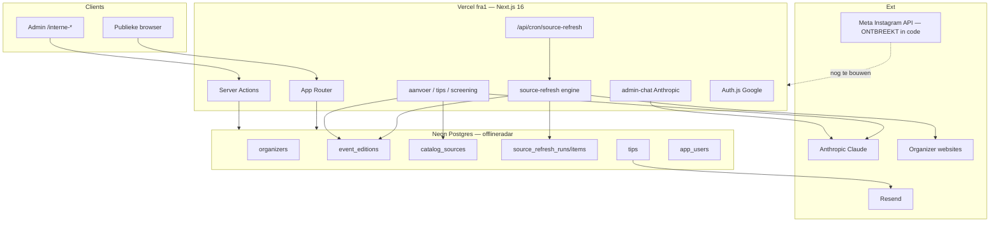

# DateOfflineHub — Volledig technisch overdrachtsrapport (Autopilot)

**Doel:** één standalone Markdown-bestand voor een externe AI-architect (ChatGPT). Dit document beschrijft de bestaande architectuur en hoe DateOfflineHub grotendeels autonoom kan werken met **maximaal hergebruik** van Next.js, Neon, Anthropic, Vercel Cron en de bestaande eventpipeline.

**Auditmodus:** read-only. Geen codewijzigingen, installs of deployments tijdens deze analyse.  
**Repository:** https://github.com/yoma/offlineradar (package name `dateofflinehub`)  
**Analysedatum:** 2026-10-20 (bijgewerkt zelfde dag: volledige hoofdstukken 3–10 + cron-probe)  
**Productnaam:** DateOfflineHub (historische codenaam OfflineRadar; env/DB behouden `OFFLINERADAR_*` / `offlineradar`)

> **Belangrijk voor ChatGPT:** dit bestand bevat **10 genummerde hoofdstukken** plus bijlagen. Als een eerdere upload stopte bij §3.1, lees hier opnieuw vanaf §3.2 tot en met §10. Stel **geen nieuwe hostingplatforms** voor tenzij aantoonbaar noodzakelijk; bouw voort op Next.js + Neon + Anthropic + Vercel Cron.

---

## Inhoudsopgave

1. [Algemene architectuur](#1-algemene-architectuur)
2. [Eventbeheer — levenscyclus](#2-eventbeheer--levenscyclus)
3. [Huidige automatisering](#3-huidige-automatisering) ← inclusief Source Refresh-engine, AI, cron-status
4. [Instagram en Meta API](#4-instagram-en-meta-api)
5. [Beveiliging, logging, foutafhandeling](#5-beveiliging-logging-foutafhandeling)
6. [Autopilot: wat kan / wat ontbreekt](#6-autopilot-wat-kan--wat-ontbreekt)
7. [Kosten en onderhoud](#7-kosten-en-onderhoud)
8. [Concreet voorstel: volledig autonoom op bestaande stack](#8-concreet-voorstel-volledig-autonoom-op-bestaande-stack)
9. [Wat niet geverifieerd kon worden](#9-wat-niet-geverifieerd-kon-worden)
10. [Snelle referentie](#10-snelle-referentie)

---

## Leeswijzer: feiten vs. aanbevelingen

| Label | Betekenis |
| --- | --- |
| **FEIT** | Vastgesteld uit code, SQL, config, HTTP-probe of toegankelijke API |
| **DEELS GEVARIFIEERD** | Sterke code-aanwijzing; productie-env of live DB niet gelezen |
| **NIET GEVARIFIEERD** | Geen toegang zonder secrets/dashboard |
| **AANBEVELING** | Voorstel; geen bestaande feature |

Geheimen, tokens en persoonsgegevens worden niet weergegeven. Alleen **namen** van env-variabelen.

---

## 1. Algemene architectuur

### 1.1 Stack (FEIT)

| Laag | Technologie | Bron |
| --- | --- | --- |
| Taal / UI | TypeScript 5, React 19.2 | `package.json` |
| Framework | **Next.js 16.3.6** App Router | `app/` |
| Styling | Tailwind 4, shadcn/Radix, Lucide | `components/ui/` |
| Auth | Auth.js v5 beta + Google OAuth | `auth.ts` |
| Database | **Neon Postgres** via `@neondatabase/serverless` | `lib/tips/db.ts`, `db/migrations/` |
| E-mail | Resend | `lib/email/resend.ts` |
| AI | Anthropic SDK | diverse `lib/*` |
| Hosting | Vercel, regio **fra1** | `vercel.json`, `app/layout.tsx` |
| Cron | Vercel Cron → `/api/cron/source-refresh` (`0 4 * * *`) | `vercel.json` |

**Niet aanwezig (FEIT):** Supabase, OpenAI SDK, Meta/Instagram Graph SDK, Stripe, Redis/Upstash, Prisma/Drizzle, GitHub Actions workflows (`total_count: 0`).

### 1.2 Frontend & admin (FEIT)

Publiek: `/`, `/ontdek`, `/event/[slug]`, `/bewaard`, `/account`, `/inloggen`, `/feedback`, `/over`, `/privacy`.

Admin (allowlist `OFFLINERADAR_ADMIN_EMAILS` via `resolveTipsAdminAccess()`):

- `/interne-dashboard`, `/interne-aanvoer`, `/interne-events`, `/interne-events/refresh/[runId]`
- `/interne-tips`, `/interne-goedkeuren`, `/interne-preview`, `/interne-feedback`

### 1.3 Backend (FEIT)

Geen aparte API-server. Route Handlers + Server Actions.

Belangrijke API’s: `/api/auth/[...nextauth]`, `/api/cron/source-refresh`, `/api/tips`, `/api/tips/admin`, `/api/interne-admin-chat`, `/api/interne-aanvoer/asset/[id]`, `/api/events/[id]/report`, `/api/analytics`.

Domeinlibs: `lib/events/`, `lib/events.ts`, `lib/source-refresh/`, `lib/aanvoer/`, `lib/tips/`, `lib/screening/`, `lib/admin-chat/`, `lib/users/`, `lib/organizers/`, `lib/analytics/`, `lib/brand/`.

### 1.4 Hosting & domein (FEIT / DEELS)

| Item | Status |
| --- | --- |
| Vercel project | `dateofflinehub` (`prj_RqZkXkAm4VjIACXAT9z2Q21kUsEL`), team YOMA / `yomai` |
| Domein | `dateofflinehub.be` geverifieerd; DNS extern (`ns1/ns2.iezie.eu`) |
| metadataBase | `https://dateofflinehub.be` (`app/layout.tsx`) |
| OpenGraph URL | `https://dateofflinehub.vercel.app` |
| Cron route live | **Ja** — HTTP 401 JSON `{"ok":false,"error":"unauthorized"}` op beide hosts (probe 2026-10-20) |
| Env-waarden / logs | Agent-scope kreeg 403/404 op env-list en runtime logs → **niet** uitgelezen |

### 1.5 Database (FEIT)

Neon project-id verwacht: `little-haze-16039117`; endpoint-id: `ep-fancy-hat-b2jkbryx`; DB-naam: `offlineradar`; regio: `eu-central-1`. Guard: `assertOfflineRadarDbConfig()` in `lib/tips/db.ts` (gedeeld via `lib/events/db.ts`).

### 1.6 Architectuurdiagram



---

## 2. Eventbeheer — levenscyclus

### 2.1 Opslag (FEIT)

Canonical: Neon `event_editions` (+ `organizers`, `event_series`, `event_sources`, `event_images`).  
Types: `types/event-catalog.ts`. CRUD: `lib/events/neon-store.ts`.  
Consumer projection: `types/event.ts` via `lib/events/map-to-consumer.ts`.

Publieke feed (`lib/events.ts`):

- `OFFLINERADAR_EVENTS_CANONICAL_FEED=1` → Neon published (max 500) + `isRouteABListable`
- anders → mock `data/events.ts`

### 2.2 Publicatiestatussen (FEIT)

`candidate` | `under_review` | `approved` | `draft` | `published` | `rejected` | `expired` | `cancelled`  
`published` vereist `published_at`. Soft offline: `takeEditionOffline`. Hub-verwijdering: `removeEditionFromHub` + tag `manual_suppressed`.

### 2.3 Hoe events binnenkomen (FEIT)

| Pad | Mechanisme | Resultaat |
| --- | --- | --- |
| Admin Quick Intake | `/interne-aanvoer` → `saveIntakeAsEventCandidate` | `draft`; publish alleen via gates |
| Source refresh standard | engine → `source_refresh_items` | `needs_review` (geen edition) |
| Source refresh thorough | `createDraftFromRefreshCandidate` | `draft` (**nooit** publish in deze functie) |
| Tips | `create-concept-event.ts` | `draft` |
| Import scripts | `scripts/import-*.ts` | meestal draft; publish apart |
| Admin chat `assess_url` | tool | draft bij singles-fit |

### 2.4 Dedupe (FEIT)

Intake (`lib/aanvoer/dedupe.ts`), refresh match (`lib/source-refresh/match.ts`), tip unique URL, DB-indexen op title/start/organizer. Best-effort + review; geen wereldwijde unique “één event”.

### 2.5 Veilige programmatische write-API (FEIT)

Server-only: `createEdition`, `upsertEditionBySlug` (mag niet zelf publishen), `updateEditionPublication` (enige expliciete publish + geo/suppression guards), `attachSource`/`attachImage`, `saveIntakeAsEventCandidate`, `createDraftFromRefreshCandidate`, `startSourceRefresh`. **Geen** publieke `POST /api/events`.

### 2.6 Productregels (FEIT)

Route A (singles-oriented) of Route B (Meet). Payment ≠ eligibility. AI beslist niet alleen over publicatie. Docs: `docs/domain-model.md`, `docs/discovery-playbook.md`.

---

## 3. Huidige automatisering

### 3.1 Inventaris (FEIT)

| Mechanisme | Aanwezig? | Detail |
| --- | --- | --- |
| Vercel Cron | Ja | `0 4 * * *` → `/api/cron/source-refresh` |
| GitHub Actions | Nee | 0 workflows |
| Supabase Edge / pg_cron | Nee | — |
| HTML parsers + generic follow | Ja | `lib/source-refresh/` |
| Anthropic AI | Ja | screening, intake, tips, admin-chat |
| Inbound webhooks (niet-auth) | Nee | — |
| Instagram publish | Nee | alleen nav-link |

### 3.2 Source Refresh-engine — werking (FEIT)

**Entrypoint:** `startSourceRefresh()` in `lib/source-refresh/engine.ts`.  
Gebruikt door: admin UI (`app/interne-events/refresh-actions.ts`), admin-chat tools (`lib/admin-chat/tools.ts`), scheduled cron (`lib/source-refresh/scheduler.ts`).

```
catalog_sources (+ refresh_enabled / notes tags)
        │
        ▼
startSourceRefresh({ catalogSourceId, triggeredBy, triggerType, mode })
        │
        ├─ dedicated parser als ID in REFRESH_PILOTS
        │     safeFetchHtmlSource → runRefreshParser → match
        └─ anders generic follow als autoFollowable
              website/agenda/websearch → AI extract kandidaten
        │
        ▼
source_refresh_runs + source_refresh_items
  detection: new | existing_unchanged | existing_changed | possibly_removed
  status:    needs_review | ignored | accepted | rejected | applied
        │
        └─ mode === "thorough" only:
             new → createDraftFromRefreshCandidate (publication_status=draft)
             changed → filterSafeAutoApplyChanges (availability/price/…)
```

**Dedicated pilots** (`lib/source-refresh/registry.ts`): SmartVibes/Speeddaten, HopToDate, Sportieve Singles, Tomeeto, Juntas (vaste `catalog_sources` UUIDs).

**Parsers:** `lib/source-refresh/parsers/{speeddaten,hoptodate,sportieve-singles,tomeeto,juntas}.ts`.

**Generic follow:** `lib/source-refresh/generic-follow.ts` — fetcht site, harvest eventlinks, gebruikt `runAdminIntakeExtract` (Anthropic). Max ~10 kandidaten, max 8 link fetches. Commentaar in file: **never auto-publishes**.

**Match/diff:** `lib/source-refresh/match.ts` — URL/path, title, datum, organizer; confidence `exact`/`probable`/`none`; unknown wist never known.

**Safe auto-apply fields** (`lib/source-refresh/apply-change.ts`): alleen `availability`, `genderAvailability`, `availabilityNote`, `price`. Geen auto title/date/city move in thorough.

**Fetch security:** `lib/source-refresh/safe-fetch-html.ts` — URL-validatie (anti-SSRF via tip URL helpers), timeout 30s, max ~1.5MB, redirects begrensd.

**Cooldown:** `source_refresh_runs`, `source_refresh_items` (`db/migrations/20260926_source_refresh_v1.sql` + schedule kolommen in `20260928_source_refresh_schedule_v1.sql`).

### 3.3 Source Refresh — beperkingen (FEIT)

1. **Scheduled mode publiceert nooit** en past geen drafts toe (`scheduler.ts` header comment). Alleen detection + review items.
2. **Thorough auto-draft publiceert nooit** (`draft-from-candidate.ts`: `publicationStatus: "draft"`).
3. **Batchcron klein:** `SCHEDULED_REFRESH_BATCH_SIZE = 3`, concurrency 2, `maxDuration = 60` op de route.
4. **Kill switch default OFF:** `OFFLINERADAR_SCHEDULED_REFRESH` moet exact `"1"` zijn (`schedule-config.ts`).
5. **Cooldown cooldown** 5 minuten tussen completed runs (tenzij skip/thorough).
6. **Human overrides winnen:** notes tags `follow_paused=1`, `follow_disabled=1`, `follow_archived=1` of `catalog status=inactive` blokkeren scheduled refresh.
7. **Social-only bronnen** (Instagram/Facebook hosts): vaak niet auto-followable zonder website (`follow-capability.ts`); discovery playbook: IG = signaal, niet scrapen.
8. **`possibly_removed`** alleen bij `listingCoverage=complete`; geen auto-unpublish.
9. **HTML-breekbaarheid:** dedicated parsers zijn fragiel bij site-redesigns.
10. **Geen open-web discovery van onbekende merken** in de engine; Source Map rijen moeten bestaan.
11. **User-supplied bronnen** (`discovered_by=user`) zijn permanent mandatory input (`lib/aanvoer/future-discovery.ts`); mogen niet verdwijnen omdat een crawl ze mist.

### 3.4 Scheduler & Vercel Cron — productiestatus

#### Config in repo (FEIT)

```json
// vercel.json
{
  "regions": ["fra1"],
  "crons": [{ "path": "/api/cron/source-refresh", "schedule": "0 4 * * *" }]
}
```

Route: `app/api/cron/source-refresh/route.ts`  
Auth: `Authorization: Bearer $CRON_SECRET` (`lib/source-refresh/cron-auth.ts`)  
Logic: `runScheduledSourceRefresh()` — skip alles als kill switch uit.

#### Live HTTP-probe zonder wijzigingen (FEIT, 2026-10-20)

| URL | Resultaat |
| --- | --- |
| `https://dateofflinehub.be/api/cron/source-refresh` | **401** `{"ok":false,"error":"unauthorized"}` |
| `https://dateofflinehub.vercel.app/api/cron/source-refresh` | **401** idem |
| Zelfde + verkeerde Bearer | **401** idem |

**Interpretatie:**

- **FEIT:** de cron-handler is **gedeployed** op productie (apex + vercel.app).
- **DEELS:** 401 is het ontworpen antwoord zonder geldig secret. Zelfde antwoord als `CRON_SECRET` ontbreekt (auth helper returnt dan ook false).
- **NIET GEVARIFIEERD:** of Vercel Cron de route dagelijks aanroept; of `CRON_SECRET` gezet is; of `OFFLINERADAR_SCHEDULED_REFRESH=1`.
- Runtime logs / env-list via Vercel MCP: **403/404** vanuit agent-scope.

**Praktische conclusie voor Autopilot:** behandel scheduled refresh als **“route live, effectieve dagelijkse werking onbewezen tot kill-switch + secret in Vercel dashboard bevestigd”**. Check in dashboard: Project → Settings → Environment Variables (`OFFLINERADAR_SCHEDULED_REFRESH`, `CRON_SECRET`) en Cron/Logs rond 04:00 UTC.

### 3.5 Bestaande AI-mogelijkheden (FEIT)

| Module | Bestanden | Doet | Beslist publicatie alleen? |
| --- | --- | --- | --- |
| Concept screening | `lib/screening/ai/anthropic-screener.ts` | Route A/B concept | Nee |
| Tip AI | `lib/tips/ai-prep.ts`, `ai-scan.ts`, `tip-screener.ts` | Tip normaliseren | Nee |
| Intake extract | `lib/aanvoer/extract.ts` | URL/tekst/screenshot → velden | Nee; gates daarna |
| Screenshot OCR | `lib/aanvoer/screenshot-ocr.ts` | Tekst uit beeld | Nee |
| Deep verify | `lib/aanvoer/deep-verify.ts` | Extra broncheck/conflicten | Beïnvloedt `canPublish` |
| Admin chat | `lib/admin-chat/agent.ts` + `tools.ts` | assess_url, scan_source, diagnose, enable follow | Kan draft maken; geen IG |
| Generic follow | `generic-follow.ts` | Hergebruikt intake extract | Alleen kandidaten/review |
| Image prompt helper | `lib/event-visual-profile.ts` | Prompt voor optionele generatie | Geen runtime generator |

Default model: `claude-haiku-4-5-20251001` via `ANTHROPIC_MODEL` override.

### 3.6 Automatische publicatiemogelijkheden (FEIT)

Er bestaan **twee verschillende** “auto”-paden; die niet verwarren:

#### A) Deterministische gate-publish (bestaat)

Functies: `evaluateIntakeApproval` (`lib/aanvoer/approval.ts`), `classifyAdminStatus` / `evaluateEventForPublication` (`admin-status.ts`, `publication-gate.ts`), daarna `updateEditionPublication`.

**Groen alleen als o.a.:** titel ok, concrete datum (geen 2099-placeholder), discoverable geo, bron-URL, Route A/B of singlesOriented/Only, geen blockers/conflicts, niet `manual_suppressed`.

Wordt aangeroepen vanuit **Server Actions** (bijv. na deep-verify in `app/interne-aanvoer/actions.ts`) wanneer `approval.canPublish`.  
**Niet** op page GET: cockpit commentaar zegt expliciet “Never auto-publish on GET”.

#### B) Refresh → draft / review (bestaat; geen publish)

- Cron/standard → `needs_review` items  
- Thorough → `draft` editions + safe field patches  

**Geen codepad** van scheduled refresh rechtstreeks naar `published`.

#### C) Wat Autopilot nog moet toevoegen (AANBEVELING)

Een gecontroleerde promote-stap: `draft` + gates groen → `updateEditionPublication(published)` vanuit een **apart** cron/action met allowlist + logging — hergebruik bestaande gate, geen nieuwe DB-engine.

### 3.7 Automatisch nieuwe organisatoren ontdekken (FEIT + AANBEVELING)

#### Wat nu bestaat

- **Handmatig discovery playbook** (`docs/discovery-playbook.md`): regio × taal × format × kanaal; expliciet “geen crawler / geen auto-import” als scope van dat document (deels historisch t.o.v. latere refresh-cron).
- **Source Map** `catalog_sources` + seed/import scripts `scripts/seed-phase*-discovery.ts`, `import-phase*-drafts.ts`.
- **Admin intake** kan nieuwe bron opslaan (`saveIntakeAsSource`) met `discovered_by=user`.
- **Admin chat `assess_url`:** onbekende URL beoordelen + draft; catalogusbron aanmaken is tool-afhankelijk / deels handmatig enable follow.
- **Generic follow** werkt alleen voor **bestaande** `catalog_sources` die auto-followable zijn.

#### Wat ontbreekt voor “dagelijks nieuwe organizers”

- Geen job die playbook-queries uitvoert tegen zoekmachines/ticketaggregators en nieuwe `catalog_sources` insert.
- Geen status `discovered_by=agent` workflow met verplichte menselijke goedkeuring vóór `refresh_enabled=true` (aan te raden).
- Instagram heefthtag/account scraping is **bewust out of scope** (ToS + playbook).

#### Haalbare uitbreiding op huidige stack (AANBEVELING)

Blijf op Next.js + Neon + Anthropic + Vercel Cron:

1. Nieuwe cron-route of tweede schedule: `/api/cron/discovery-sweep` (zelfde auth-patroon als source-refresh).  
2. Input: query-matrix uit playbook (NL/FR/EN × steden × formats) als data in `data/` of Neon-tabel.  
3. Voor hits: Anthropic classificeert Route A/B; schrijf `catalog_sources` met `status=promising`, `refresh_enabled=false`, notes `discovered_by=agent`.  
4. Admin ziet ze in `/interne-aanvoer` Bronnen; pas na enable volgt bestaande refresh-engine.  
5. Geen nieuw platform nodig; wel rate-limits en ToS per bron respecteren.

---

## 4. Instagram en Meta API

### 4.1 Wat de codebase heeft (FEIT)

| Onderdeel | Status |
| --- | --- |
| Nav-link `https://www.instagram.com/dateofflinehub/` | Ja (`components/layout/site-nav.tsx`) |
| `Event.instagramUrl` uit social sources | Ja (`map-to-consumer.ts`) |
| Brand tokens + `instagramFormats` 1080×1350 / 1080×1920 / 1080×1080 | Ja (`lib/brand/tokens.ts`) — “Do not build exporters here yet” |
| Mood images Unsplash + semantic matching | Ja |
| `buildVisualGenerationPrompt` | Ja — geen gekoppelde generator |
| Meta Graph / Content Publishing client | **Afwezig** |
| Social post queue / schedule tabel | **Afwezig** |
| Caption/carousel generator job | **Afwezig** |

### 4.2 Vereiste Meta / Instagram API-rechten (AANBEVELING — platformvereisten, geen “nieuw hostingplatform”)

Om officieel te publiceren op `@dateofflinehub` is typisch nodig:

1. **Instagram Professional** account (Business of Creator), gekoppeld aan een **Facebook Page**.  
2. **Meta Developer App** in Business Manager.  
3. Product: Instagram Graph API (of Instagram API with Instagram Login, afhankelijk van Meta’s actuele onboarding).  
4. Permissies (namen kunnen door Meta wijzigen; verifieer in Meta docs bij implementatie), typisch in de trant van:
   - content publish (bijv. `instagram_content_publish` / `instagram_business_content_publish`)
   - basis account/media read
   - page toegang / token exchange waar Page-based flow geldt  
5. **App Review** voor publish-permissions (development mode beperkt tot testers).  
6. Long-lived access tokens of token-refresh process → opslaan als Vercel env (server-only), nooit `NEXT_PUBLIC_*`.  
7. Publishing flow Graph API: create media container → poll status → publish; carousels/reels hebben extra stappen.  
8. Rate limits, spam/quality policies, geen scraping van andermans IG-content.

**Ontbrekende tech-onderdelen in DateOfflineHub:**

- `lib/instagram/` (of `lib/social/`) client  
- Neon tabel bv. `social_posts` (`event_edition_id`, caption, asset urls, status draft/scheduled/published/failed, meta_media_id, scheduled_at, published_at)  
- Renderer: brand template → JPEG/PNG 1080×1350 (Canvas/Satori in Next.js route of pre-render in cron)  
- Cron bv. `/api/cron/instagram-publish` hergebruikend `CRON_SECRET`  
- Idempotency: één post per edition per dag/type  

### 4.3 Aanbevolen IG-beleid binnen Autopilot

- Alleen **reeds published** events als bron van waarheid.  
- Week 1–2: queue `needs_review` voor captions; daarna auto voor high-confidence.  
- Max N posts/dag.  
- Geen inventie van prijzen/leeftijden; kopieer uit Neon edition fields.  
- Visuals: official image indien aanwezig, anders mood/brand template (geen random mismatch — bestaande image-compatibility hergebruiken).

---

## 5. Beveiliging, logging, foutafhandeling

### 5.1 Auth & rollen (FEIT)

- Google OAuth: scopes `openid email profile` only.  
- Publieke users in `app_users` — **geen** admin in JWT.  
- Admin: server-side allowlist `OFFLINERADAR_ADMIN_EMAILS`.  
- Dev bypass alleen non-production.

### 5.2 Schrijfbescherming (FEIT)

| Actie | Gate |
| --- | --- |
| Tips public submit | feature flags |
| Event report | publiek + rate limit (IP hash) |
| Analytics | anoniem |
| Catalog/intake/refresh/publish | admin allowlist |
| Cron | `CRON_SECRET` |

### 5.3 Env-variabelen — namen only (FEIT)

`OFFLINERADAR_DATABASE_URL`, `OFFLINERADAR_NEON_PROJECT_ID`, `AUTH_SECRET`, `AUTH_GOOGLE_ID`, `AUTH_GOOGLE_SECRET`, `OFFLINERADAR_ADMIN_EMAILS`, `ANTHROPIC_API_KEY`, `ANTHROPIC_MODEL`, `RESEND_API_KEY`, `OFFLINERADAR_EMAIL_FROM`, `CRON_SECRET`, `OFFLINERADAR_SCHEDULED_REFRESH`, `OFFLINERADAR_EVENTS_CANONICAL_FEED`, `OFFLINERADAR_TIPS_*`, `OFFLINERADAR_INTERNAL_PREVIEW`, `OFFLINERADAR_RATE_LIMIT_SECRET`, `OFFLINERADAR_PUBLIC_BASE_URL`, `NEXT_PUBLIC_APP_URL`, `OFFLINERADAR_APP_NAME`, `NEXT_PUBLIC_BETA_WELCOME_ENABLED`, `SOURCE_REFRESH_SKIP_COOLDOWN`, `VERCEL_ENV`, `VERCEL_PROJECT_PRODUCTION_URL`.

Later voor IG (nog niet in code): bv. `META_IG_USER_ID`, `META_PAGE_ACCESS_TOKEN` / refresh secrets — **niet** committen.

### 5.4 Database (FEIT)

Parameterized SQL via Neon tagged templates. Geen RLS in migraties; beveiliging = connection string + app guards. Intake screenshots in `admin_intake_assets` (admin-only).

### 5.5 Logging & fouten (FEIT)

- `console.error` op cron failures; JSON aggregaten in cron response (bewust beperkt).  
- `EventsCatalogUnavailableError` voor publieke feed.  
- Geen Sentry/APM dependency.  
- Refresh runs bewaren status/error/counts in Neon (auditbaar).  
- Tip/report rate tables.

**Back-ups:** Neon PITR hangt van plan af — **NIET GEVARIFIEERD**.

### 5.6 Aanbevelingen observability (AANBEVELING, op bestaande stack)

- Cron response + `source_refresh_runs` al querybaar in admin UI uitbreiden.  
- Optioneel: Vercel log drains later; geen verplicht nieuw platform nu.  
- Alert: `consecutiveFailures >= 2` bestaat al in follow-status (`aandacht_nodig`).

---

## 6. Autopilot: wat kan / wat ontbreekt

### 6.1 Capability-matrix

| # | Doel | Nu | Gat op bestaande stack |
| --- | --- | --- | --- |
| 1 | Dagelijks events bij bekende organizers | Cron + parsers + generic follow | Kill-switch/secret bevestigen; meer `refresh_enabled` |
| 1b | Nieuwe organizers | Playbook + intake + assess_url | Discovery-sweep cron → `catalog_sources` drafts |
| 2 | Feiten controleren | Parsers, deep-verify, extract, freshness | Bronafhankelijk; social-first zwak |
| 3 | Dubbels / wijzigingen / annuleringen | Match + possibly_removed + safe apply | Auto-cancel policy + promote/reject job |
| 4 | Betrouwbaar auto toevoegen | Gate-publish op actions; thorough → draft | Promote-job draft→published via bestaande gates |
| 5 | Twijfel → goedkeuring | `needs_review` + `aandacht_nodig` | Goed herbruikbaar |
| 6 | IG content | Brand + mood + prompt | Renderer + captions |
| 7 | IG publish Meta API | Ontbreekt | Meta app + `lib/instagram` + cron |
| 8 | Overzicht discovered/rejected/published | Deels (runs/items/cockpit/tips) | Optionele `autopilot_ledger` tabel in Neon |
| 9 | Zonder open laptop | Vercel Cron route live | Flags aan; eventueel 2e/3e cron paths |

### 6.2 Architectuurkeuze (AANBEVELING)

**Blijf bij Next.js + Neon + Anthropic + Vercel Cron.**  
Geen Supabase, geen apart agent-hostingproduct, geen verplichte GitHub Actions als primaire scheduler.

Alleen Meta Graph is een **noodzakelijke externe API** voor officiële IG-publicatie (vergelijkbaar met Anthropic/Resend), geen vervanging van de app-stack.

Cursor Automations: hoogstens optioneel voor experimentele discovery; **voldoet niet** aan eis #9 als enige runtime.

---

## 7. Kosten en onderhoud

### 7.1 Bestaand (DEELS)

| Component | Typisch | Onzekerheid |
| --- | --- | --- |
| Vercel | Hobby of Pro | Plan niet uit API gelezen; Cron betrouwbaarder op Pro |
| Neon | Free/Launch | Plan niet geverifieerd; EU project bestaat |
| Anthropic | usage | Haiku default dempt kost |
| Resend | free/paid | tipmails |
| Domein `.be` | registrar | DNS bij iezie |
| Unsplash hotlink | ToS | attribution/beleid |

### 7.2 Autopilot-meerprijs (AANBEVELING)

- Meer Anthropic tokens (discovery + captions + generic follow)  
- Eventueel Vercel Pro als Hobby cron limieten knellen  
- Neon storage/compute bij groeiende runs/items/posts  
- Meta API zelf meestal $0; tijd voor Business verification  
- Onderhoud parsers = grootste “kost” in uren

### 7.3 Schaal & stabiliteit

- Feed nu capped ~500 published bundles in `listEvents` — later pagineren.  
- Cron 60s + batch 3: schaal door **meer cron ticks / intervals**, niet door nieuwe orchestrator tenzij bewezen tekort.  
- Parser breakage: monitor `source_refresh_runs.status=failed` + consecutiveFailures.

---

## 8. Concreet voorstel: volledig autonoom op bestaande stack

Dit is het uitvoerbare Autopilot-plan **zonder nieuw platform**. Alles landt in dezelfde Next.js-app en Neon-DB.

### 8.0 Principe

```
Ontdek/ververs  →  draft of needs_review  →  bestaande gates  →  published
                                                              →  (later) social_posts → Meta
```

Mens grijpt in via bestaande `/interne-*` queues. AI assisteert; gates beslissen.

### 8.1 Fase 0 — Productie bevestigen (geen feature code verplicht)

1. In Vercel Production env controleren/zetten:
   - `OFFLINERADAR_EVENTS_CANONICAL_FEED=1`
   - `OFFLINERADAR_SCHEDULED_REFRESH=1`
   - `CRON_SECRET` aanwezig; Vercel Cron stuurt Bearer automatisch bij juiste setup
   - `ANTHROPIC_API_KEY`, Neon URL, admin emails
2. Na 04:00 UTC: controleren of `source_refresh_runs` met `trigger_type=scheduled` verschijnen (via admin UI of SQL).  
3. High-yield `catalog_sources.refresh_enabled=true` voor pilots.

**Succes:** dagelijkse runs zonder laptop.

### 8.2 Fase 1 — Autopilot Ingest (events bij bekende bronnen)

**Hergebruik:** `startSourceRefresh`, scheduler, match, draft-from-candidate, `updateEditionPublication`, admin gates.

**Nieuw (klein, in-repo):**

1. Optioneel tweede cron of weekly thorough-trigger voor allowlist (mode thorough) → meer drafts.  
2. Nieuwe route `/api/cron/promote-drafts` (zelfde `CRON_SECRET`):
   - selecteer `event_editions` met `publication_status='draft'` (of refresh-accepted)
   - run `evaluateEventForPublication` / bestaande checks
   - bij `publish` → `updateEditionPublication`
   - bij twijfel → laat `draft` / zet admin-status reden in `internal_notes`
   - respecteer `manual_suppressed`
3. Ledger: ofwel views op bestaande tabellen, of één tabel `autopilot_actions (id, kind, ref_id, decision, reason, created_at)`.

**Niet doen:** scheduled refresh zelf laten publishen (houd scheiding detection vs promote).

### 8.3 Fase 2 — Nieuwe organisatoren

1. Data: playbook query-lijst in code/Neon.  
2. Cron `/api/cron/discovery-sweep`: zoek/fetch → Anthropic Route A/B → insert `catalog_sources` (`promising`, `refresh_enabled=false`, `discovered_by=agent`).  
3. Admin enable in bestaande Bronnen-UI → bestaande engine neemt over.  
4. Geen IG scraping.

### 8.4 Fase 3 — Expiry / wijzigingen / annuleringen

1. Bij `possibly_removed` + hoge confidence: promote naar `under_review` of `cancelled` volgens strikte regels (start met queue only).  
2. Safe field apply mag in thorough blijven.  
3. Dagelijkse “stale published” check op `source_checked_at` ouder dan X dagen → admin aandacht (freshness UI bestaat deels).

### 8.5 Fase 4 — Instagram Autopilot

1. Meta Business + IG professional + app review (rechten §4.2).  
2. `lib/instagram/publish.ts` + env tokens.  
3. Neon `social_posts`.  
4. Template render met `lib/brand/tokens.ts` maten.  
5. Caption via Anthropic uit published edition JSON (geen hallucinatie van ontbrekende feiten).  
6. Cron `/api/cron/instagram-publish`: scheduled → Meta container/publish; failures terug naar queue.  
7. Start met 1 post/dag + menselijke approve-flag.

### 8.6 Fase 5 — Hardening

- Budget cap Anthropic (max calls/dag in code).  
- Parser contract tests (bestaande `scripts/verify-*` uitbreiden).  
- Cron metrics in `/interne-dashboard`.  
- Documenteer kill switches: `OFFLINERADAR_SCHEDULED_REFRESH`, per-bron pause tags, promote cron flag.

### 8.7 Doelarchitectuur na Autopilot

```mermaid
flowchart LR
  C1["Cron 04:00 source-refresh"] --> E[startSourceRefresh]
  C2["Cron promote-drafts"] --> G[publication gates]
  C3["Cron discovery-sweep"] --> CS[catalog_sources promising]
  C4["Cron instagram-publish"] --> Meta[Meta Graph API]
  E --> Items[refresh items / drafts]
  Items --> G
  G --> Pub[event_editions published]
  Pub --> C4
  CS --> Admin[Admin enable follow]
  Admin --> E
  Pub --> Web[/ontdek]
```

Alles binnen **één** Vercel Next.js project + **één** Neon database + Anthropic + Meta.

### 8.8 Risico’s

| Risico | Mitigatie in dit voorstel |
| --- | --- |
| Verkeerde auto-publish | Gescheiden promote-job + bestaande gates + suppression |
| Cron “aan” in config maar kill-switch uit | Fase 0 checklist |
| Parser breakage | consecutiveFailures → aandacht_nodig |
| Meta rejection / token expiry | social_posts failed + alert; geen scraping fallback |
| Cost runaway | Haiku + daily caps + batch limits (al 3/tick) |
| Nieuwe organizer noise | refresh_enabled default false |

---

## 9. Wat niet geverifieerd kon worden

- Of `OFFLINERADAR_SCHEDULED_REFRESH` in Production op `1` staat  
- Of Vercel Cron invocations historisch slagen (logs 403 voor deze agent)  
- Of `CRON_SECRET` gezet is (401 alleen bewijst dat unauthorized responses werken)  
- Live aantallen `refresh_enabled` bronnen / recente `trigger_type=scheduled` runs  
- Neon/Vercel/Resend plan & factuur  
- Of `@dateofflinehub` al Meta Business / Professional API-ready is  
- Exacte actuele Meta permission strings (verifieer bij implementatie tegen Meta docs)

---

## 10. Snelle referentie

**Eén zin:** DateOfflineHub is Next.js+Neon singles-catalogus met gate-gestuurde publicatie, semi-automatische source refresh (Vercel Cron route live; effectieve scheduling onbewezen tot env-check), Anthropic als assistent, en nog **geen** Instagram Graph publishing.

**Hergebruik eerst:** `catalog_sources` → `startSourceRefresh` → drafts/items → `evaluateEventForPublication` / `updateEditionPublication` → later `social_posts` + Meta.

**Invariants:** Route A/B; payment ≠ eligibility; AI ≠ soevereine publisher; `manual_suppressed` blokkeert; freshness ≠ createdAt; screenshots ≠ publieke images.

**Bestanden om te openen:**  
`vercel.json`, `app/api/cron/source-refresh/route.ts`, `lib/source-refresh/engine.ts`, `scheduler.ts`, `registry.ts`, `draft-from-candidate.ts`, `lib/aanvoer/approval.ts`, `publication-gate.ts`, `lib/events/neon-store.ts`, `lib/brand/tokens.ts`, `docs/discovery-playbook.md`, `db/migrations/20260926_*.sql`.

---

### Bijlage A — Cron-probe ruwe bevindingen

```
GET https://dateofflinehub.be/api/cron/source-refresh
→ 401 {"ok":false,"error":"unauthorized"}

GET https://dateofflinehub.vercel.app/api/cron/source-refresh
→ 401 {"ok":false,"error":"unauthorized"}

GET + Authorization: Bearer deliberately-wrong
→ 401 {"ok":false,"error":"unauthorized"}
```

Codepad: `isCronRequestAuthorized` → bij falen `NextResponse.json({ ok:false, error:"unauthorized" }, { status:401 })`.

### Bijlage B — Safe auto-apply velden

`availability`, `genderAvailability`, `availabilityNote`, `price` (`SAFE_AUTO_APPLY_FIELDS` in `lib/source-refresh/apply-change.ts`).

### Bijlage C — Follow override tags

`follow_paused=1`, `follow_disabled=1`, `follow_archived=1` in `catalog_sources.notes`.

---

*Einde volledig overdrachtsrapport. Upload dit hele bestand naar ChatGPT. Vraag expliciet om analyse vanaf hoofdstuk 3.2 als de vorige sessie daar stopte.*
